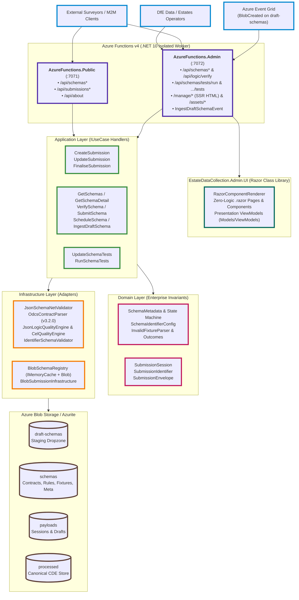
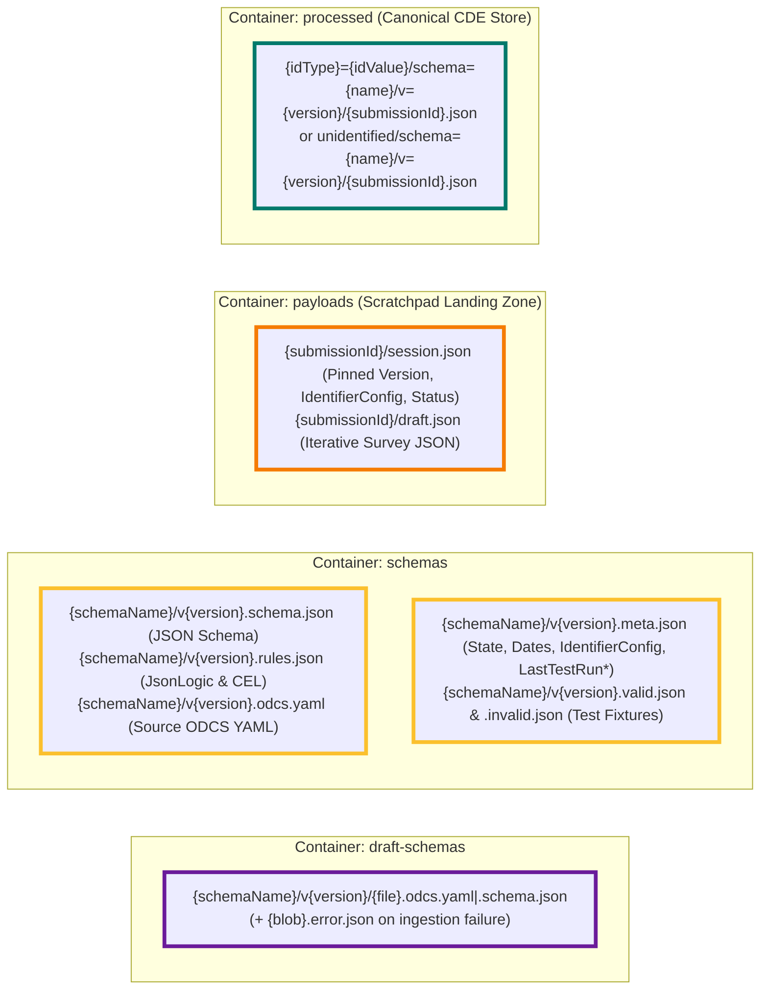
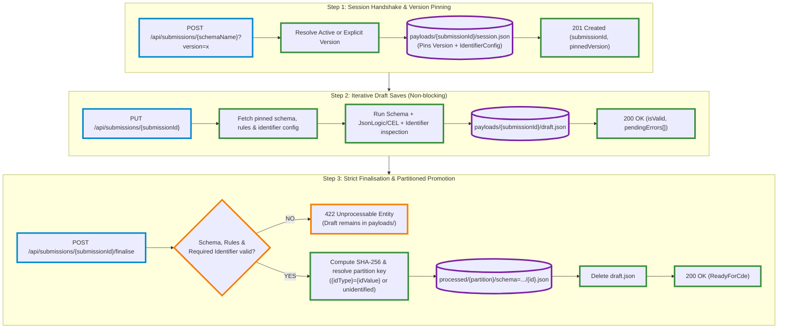
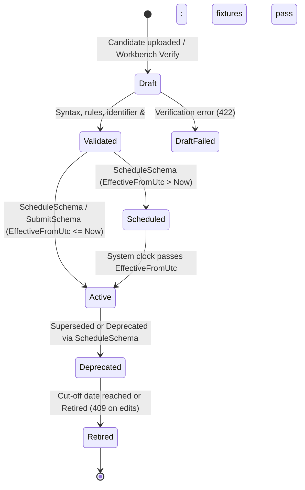

# Estate Data Collection (EDC) Platform
### Technical Architecture, Dynamic Contracts, Regression Testing & Infrastructure Guide

The **Estate Data Collection (EDC)** platform is a data ingestion and contract governance service built on **.NET 10** for the **Department for Education (DfE) Education Estates Directorate (EED)**. It ingests condition surveys and school estate returns, validates payloads against dynamic versioned contracts (**JSON Schema Draft 2020-12 / Draft-07**, **ODCS v3.2.0 YAML**, plus **JsonLogic** and **CEL** business quality rules), extracts schema-verified establishment identifiers, maintains landing-zone draft workspaces, promotes verified submissions for downstream **Common Data Environment (CDE)** ingestion, and provides a **DfE / GOV.UK SSR Admin Portal** for schema inspection, workbench verification, scheduling, and regression testing.

---

## 1. High-Level System Architecture

The service follows **Clean Architecture** organized around generic **Use Cases** (`IUseCase<TResult, TRequest>`). Domain invariants and business orchestration are completely isolated from transport hosts (`AzureFunctions.Public` and `AzureFunctions.Admin`) and UI rendering (`EstateDataCollection.Admin.UI`).



---

## 2. Infrastructure & Storage Topology

Persistence is decoupled across four Azure Blob Storage containers separating draft staging, immutable contract artefacts, active survey scratchpads, and sealed CDE-ready outputs:



### Container Directory Conventions & Responsibilities

| Container | Blob Path Pattern(s) | Responsibility | Lifecycle |
| :--- | :--- | :--- | :--- |
| **`draft-schemas`** | `{file}.odcs.yaml`, `{file}.schema.json`, `{file}.error.json` | Event Grid-watched dropzone for draft contract ingestion; writes diagnostic `.error.json` alongside failed drops. | **Staging** |
| **`schemas`** | `{schemaName}/v{version}.schema.json`<br/>`{schemaName}/v{version}.rules.json`<br/>`{schemaName}/v{version}.odcs.yaml`<br/>`{schemaName}/v{version}.meta.json`<br/>`{schemaName}/v{version}.valid.json`<br/>`{schemaName}/v{version}.invalid.json` | Immutable schema contracts, compiled quality rules, identifier metadata, test run telemetry, and mutable golden regression test fixture arrays. | **Contracts Immutable** once Validated/Scheduled/Active; **Test fixtures mutable** via verified `UpdateSchemaTests` |
| **`payloads`** | `{submissionId}/session.json`<br/>`{submissionId}/draft.json` | Holding workspace for active survey sessions and partial draft uploads. | **Temporary**. Deleted on finalisation or Azure Blob lifecycle policies |
| **`processed`** | `urn={urn}/schema={name}/v={v}/{id}.json`<br/>`{partitionLabel}={value}/...`<br/>`unidentified/schema={name}/v={v}/{id}.json` | Sealed payloads tagged `ReadyForCde` with SHA-256 hash and audit metadata, partitioned by configured `SchemaIdentifierConfig` ([ADR 0019](docs/decisions/0019-configurable-schema-verified-identifier-partitioning.md)). | **Permanent Canonical Record** |

---

## 3. Three-Stage Validation & Ingestion Pipeline

Payloads submitted via the Public API and fixtures evaluated during contract verification/regression testing share the exact same three-stage validation pipeline:

1. **Stage 1 — Structural Contract (`JsonSchemaNetValidator`):** Evaluates JSON Schema Draft 2020-12 or Draft-07 (including compiled ODCS v3.2.0 schema definitions).
2. **Stage 2 — Business Logic / Quality Rules (`JsonLogicValidator`):** Executes attached **JsonLogic** and **CEL (`CelQualityEngine`)** rules (`severity`, `dimension`, `id`, `path`, `message`).
3. **Stage 3 — Verified Establishment Identifier (`SubmissionIdentifier` + `IdentifierSchemaValidator`):**
   - Each schema version stores a `SchemaIdentifierConfig` (`Type` partition label, `JsonPointer` e.g. `/urn` or `/school/urn`, `Required` derived from JSON Schema AST, or `Type = "None"` to disable).
   - Validated at schema author/schedule time via `IdentifierSchemaValidator` so non-existent or non-scalar pointers are rejected before activation.



---

## 4. Schema Lifecycle, Verification & Stored Regression Tests

Schemas support ODCS v3.2.0 YAML contracts or raw JSON Schema + companion `.rules.json` arrays and progress through an immutable lifecycle state machine:



### Stored Regression Test Suites & Soft Warnings ([ADR 0020](docs/decisions/0020-schema-regression-test-suites-and-soft-warnings.md) & [ADR 0022](docs/decisions/0022-authoring-schema-test-fixtures-and-expected-errors.md))

- **Live Test Runs (`RunSchemaTestsUseCase` / `POST /api/schemas/tests/run`):** Evaluates all non-retired schemas (or a single schema version) against all three validation stages and persists `LastTestRunAtUtc`, `LastTestRunAppVersion`, `LastTestRunPassed`, `LastTestRunErrors`, `LastTestRunInvalidFixtures`, and `LastTestRunWarnings` onto `SchemaMetadata`.
- **Fixture Mutability (`UpdateSchemaTestsUseCase` / `PUT /api/schemas/{schemaName}/versions/{version}/tests`):** Allows teams to add or update `.valid.json` and `.invalid.json` test suites for existing schema versions after passing full verification—with automatic blob rollback on write failure—without altering the immutable contract.
- **Expected-Error Assertions & Soft Warnings (`InvalidFixtureParser`):**
  - Negative test entries support an annotated wrapper: `{"description": "...", "payload": {...}, "expectedErrors": ["RULE-..."]}`.
  - Assertions match case-insensitive substrings against runtime diagnostics (`[Rule:<Id>]`, `[Schema]`, `[Identifier]`, `[JSON]`). Every token in `expectedErrors` must match.
  - Bare negative payloads without `expectedErrors` remain non-blocking: they pass if they fail validation and emit a **soft warning** (`"Failed — unknown if expected"`) surfacing all triggered error strings so authors can promote them to explicit assertions.

---

## 5. Admin Portal Architecture ([ADR 0017](docs/decisions/0017-ssr-admin-portal-and-proxy-boundary.md) & [ADR 0018](docs/decisions/0018-zero-logic-razor-views-and-presentation-viewmodels.md))

- **Pure Static SSR + Progressive Enhancement:** [`EstateDataCollection.AzureFunctions.Admin`](src/EstateDataCollection.AzureFunctions.Admin) hosts the SSR portal routes (`/manage/*`, `/assets/*`), rendering compliant GOV.UK Frontend / DfE Branding HTML via [`RazorComponentRenderer`](src/EstateDataCollection.Admin.UI/Rendering/RazorComponentRenderer.cs) (`HtmlRenderer`) and serving embedded CSS, fonts, images, and minimal vanilla JS (`workbench.js`) directly from `EstateDataCollection.Admin.UI` via `StaticAssetEndpoint`.
- **Unified In-Process Host (`"routePrefix": ""`):** Admin UI endpoints resolve `IUseCase<TResult, TRequest>` directly in-process inside `EstateDataCollection.AzureFunctions.Admin`, while JSON API routes retain explicit `api/...` route prefixes with `AuthorizationLevel.Function`.
- **Zero-Logic `.razor` Templates:** Every `.razor` page and component binds exclusively to precomputed properties, boolean flags, and child projection records in `EstateDataCollection.Admin.UI/Models/ViewModels/*.cs`. No `@{ ... }` blocks, helper methods, LINQ, URL encoding, or date/JSON formatting exist inside `.razor` templates.
- **Portal Routes:**
  - `GET /manage` — Schema catalogue dashboard with `SchemaSectionCard` test status badges (`Passed`, `Passed (warnings)`, `Failed`, `Not run`) and global `POST /manage/tests/run` trigger.
  - `GET/POST /manage/workbench` & `POST /manage/workbench/verify` — Interactive ODCS/JSON Schema authoring, auto-discovered identifier selection, and dry-run verification.
  - `GET /manage/schemas/{schemaName}/` & `.../details` — Version overview, interactive schema field tree, quality rules viewer, and raw contract preview.
  - `GET/POST /manage/schemas/{schemaName}/{version}/schedule` — Lifecycle window and identifier configuration management.
  - `GET/POST /manage/schemas/{schemaName}/{version}/tests` & `.../tests/run` — Stored fixture viewer, inline test editor, and per-version test execution.

---

## 6. Unified API Response Envelope

Every HTTP API endpoint returns a consistent `ApiResponse<T>` contract (`Successful`, `Data`, and RFC 7807 `ProblemDetails` on failure):

#### Success Pattern (`200 OK` / `201 Created`):
```json
{
  "successful": true,
  "data": {
    "submissionId": "0192e2b4-7f12-7000-a549-39f826bc5411",
    "schemaName": "cdc_survey",
    "version": 1
  }
}
```

#### Failure Pattern (`422 Unprocessable Entity` / `404 Not Found`):
```json
{
  "successful": false,
  "problem": {
    "status": 422,
    "title": "Schema.ContractViolation",
    "detail": "Payload failed schema validation.",
    "errors": {
      "urn": ["Value is 'string' but should be 'integer'"],
      "school_address": ["Required property 'school_address' not found"]
    }
  }
}
```

---

## 7. Key Design Decisions & Guarantees

1. **Zero-Code Contract Evolution ([ADR 0002](docs/decisions/0002-dynamic-json-schema-contract-validation.md)):** Payloads and quality rules (`JsonLogic` / `CEL` / ODCS v3.2.0) are evaluated dynamically at runtime without C# DTO redeployments.
2. **Version Pinning & Contract Immutability ([ADR 0004](docs/decisions/0004-session-based-draft-ingestion-and-schema-pinning.md)):** In-flight survey sessions remain pinned to the schema version and `SchemaIdentifierConfig` active at creation; committed contracts are immutable across versions while regression test suites remain maintainable (`UpdateSchemaTestsUseCase`).
3. **Schema-Verified Identifier Partitioning ([ADR 0019](docs/decisions/0019-configurable-schema-verified-identifier-partitioning.md)):** Identifier pointers and requiredness are verified against the schema AST up front so processed lake partitions stay consistent and explicitly opt-out schemas route cleanly to `unidentified/`.
4. **Zero-Pollution Integration Testing ([ADR 0021](docs/decisions/0021-isolated-ephemeral-azurite-test-containers.md)):** Automated integration suites execute inside unique ephemeral Azurite containers (`test-{runId}-*`) and clean up on disposal.
5. **Landing Zone Defense ([ADR 0003](docs/decisions/0003-multi-container-blob-storage-landing-zone.md)):** Downstream CDE pipelines subscribe strictly to `processed/`; unfinalised drafts remain isolated in `payloads/`.
