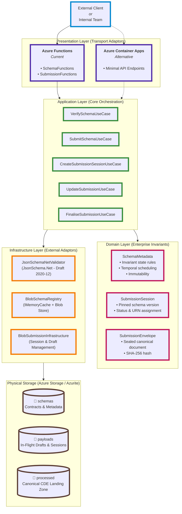
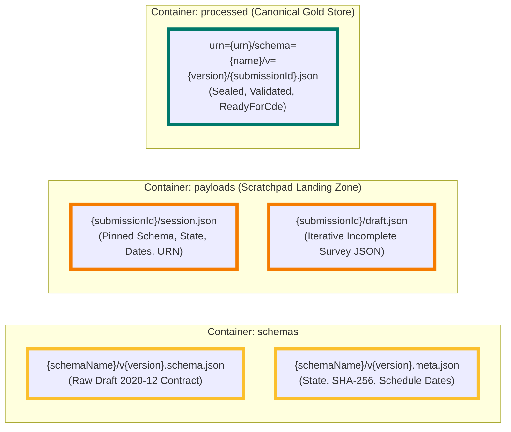
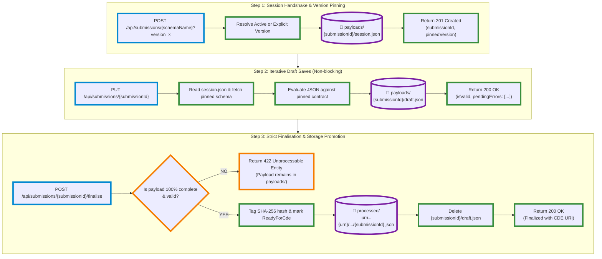
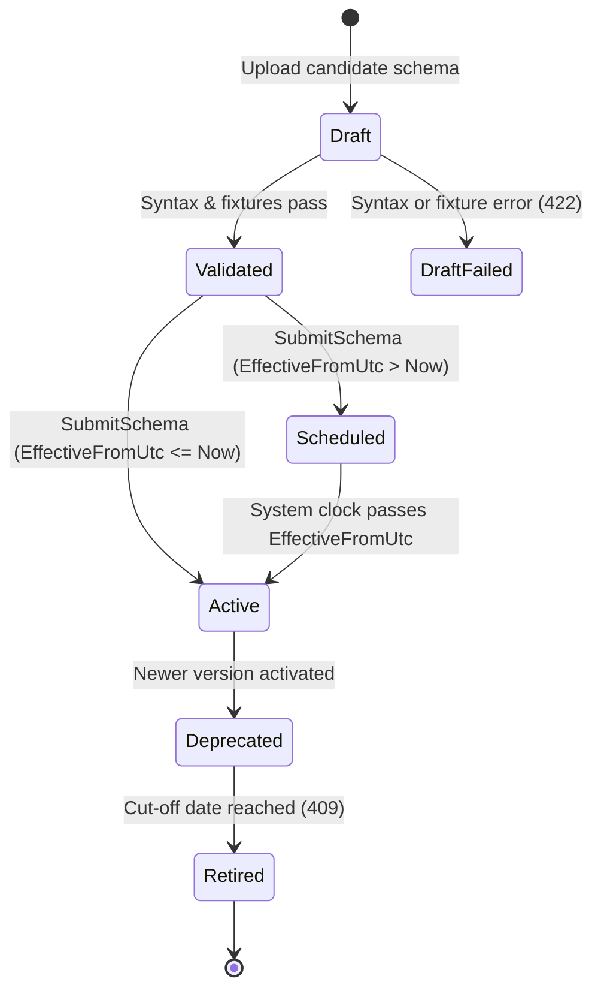
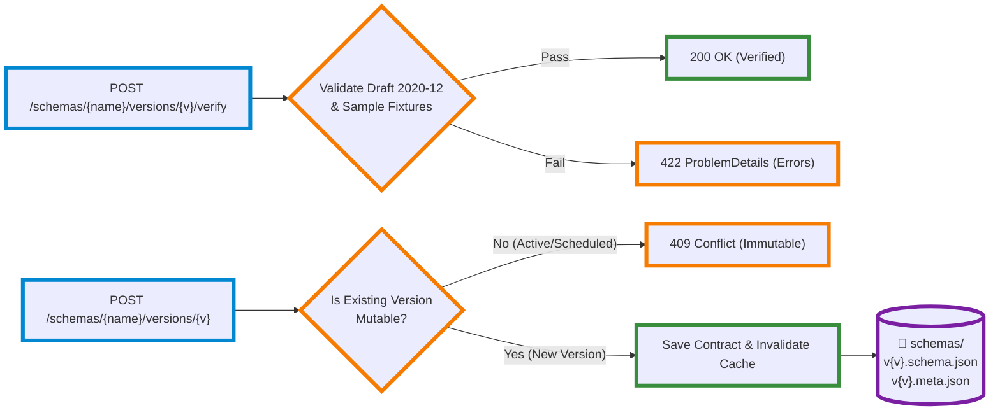

# Estate Data Collection (EDC) Platform
### Technical Architecture, Ingestion Pipeline & Infrastructure Guide

The **Estate Data Collection (EDC)** platform is a machine-to-machine (M2M) ingestion service built on **.NET 10** designed for the **Department for Education (DfE) Education Estates Directorate (EED)**. It ingests condition survey data submitted by surveyors, validates payloads against dynamic versioned contracts, maintains landing-zone draft workspaces, and promotes verified submissions for downstream **Common Data Environment (CDE)** consumption.

---

## 1. High-Level System Architecture

The service follows **Clean Architecture** organized around generic **Use Cases** (`IUseCase<TResult, TRequest>`). This completely isolates the domain and business orchestration from the hosting transport, allowing the application to run interchangeably on **Azure Functions (.NET 10 Isolated Worker)** or **Azure Container Apps (ACA) / Minimal APIs** without code modifications.



---

## 2. Infrastructure & Storage Topology

All data persistence is decoupled into three dedicated Azure Blob Storage containers, providing strict isolation between contracts, in-flight work-in-progress drafts, and finalized records.



### Container Directory Conventions & Responsibilities

| Container | Path Pattern | Responsibility | Lifecycle |
|---|---|---|---|
| **`schemas`** | `{schemaName}/v{version}.schema.json`<br/>`{schemaName}/v{version}.meta.json` | Stores official JSON Schema contracts and lifecycle schedules. | **Permanent & Immutable** once active. |
| **`payloads`** | `{submissionId}/session.json`<br/>`{submissionId}/draft.json` | Holding area for active survey sessions and draft uploads. | **Temporary**. Pruned on finalization or by Azure Blob Lifecycle retention policies. |
| **`processed`** | `urn={urn}/schema={name}/v={version}/{submissionId}.json` | Sealed surveys tagged `ReadyForCde` with SHA-256 integrity hash and audit metadata. | **Permanent canonical record** for CDE ingestion. |

---

## 3. End-to-End Survey Ingestion Lifecycle

Surveyors inspect school estates iteratively. The system enables partial uploads with real-time feedback before a strict finalization gate moves the verified survey to `processed/`.



---

## 4. Zero-Code Schema Evolution & Lifecycle

The Data Team can modify, deprecate, and activate schemas dynamically without requiring developer intervention, pull requests, or application deployments.



### Dynamic Verification Workflow



---

## 5. Unified API Response Envelope

Every endpoint returns a consistent `ApiResponse<T>` contract. Successful responses omit `Problem`, and failure responses omit `Data` while exporting standard RFC 7807 `ProblemDetails`:

#### Success Pattern (`200 OK` / `201 Created`):
```json
{
  "successful": true,
  "data": {
    "submissionId": "0192e2b4-7f12-7000-a549-39f826bc5411",
    "schemaName": "edc_payload",
    "version": 1
  }
}
```

#### Failure Pattern (`422 Unprocessable Entity` / `404 Not Found`):
```json
{
  "successful": false,
  "problem": {
    "status": 422,
    "title": "Schema.ContractViolation",
    "detail": "Payload failed schema validation.",
    "errors": {
      "urn": ["Value is 'string' but should be 'integer'"],
      "school_address": ["Required property 'school_address' not found"]
    }
  }
}
```

---

## 6. Key Design Decisions & Guarantees

1. **Zero-Code Evolution (ADR-002)**: Payloads are validated dynamically at runtime using `JsonSchema.Net` (Draft 2020-12) rather than strongly-typed C# DTOs.
2. **Version Pinning**: When a submission session is created, the schema version is stamped on `session.json`. Even if a newer schema version becomes active mid-survey, the surveyor’s in-flight survey remains anchored to its original contract.
3. **Immutability of Active Contracts**: Once a schema version has been committed and marked active/scheduled, it cannot be modified or overwritten. Changes must be registered under version $N+1$.
4. **Landing Zone Defense**: Downstream pipelines (CDE / Silver ETL) subscribe strictly to the `processed` container. Incomplete drafts or invalid payloads in `payloads` are isolated from production consumers.
