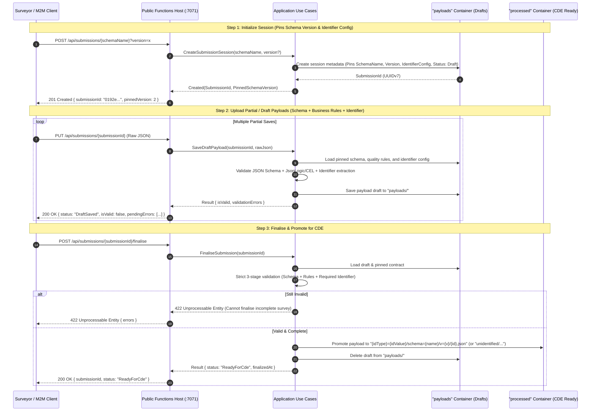

# Estate Data Collection (EDC) Service

Data ingestion, dynamic contract governance, and regression testing platform for the **Department for Education (DfE) Education Estates Directorate (EED)**.

The service evaluates incoming survey and estate payloads against versioned **JSON Schema (Draft 2020-12 / Draft-07)** and **ODCS v3.2.0 YAML** contracts with attached **JsonLogic** and **CEL** business quality rules, performs configurable **schema-verified establishment identifier extraction** (`URN`, `LAEstab`, `UKPRN`, custom pointer, or omitted), orchestrates draft and finalised submissions across dedicated Azure Blob Storage containers (`schemas`, `draft-schemas`, `payloads`, `processed`), and provides a **DfE / GOV.UK Design System SSR Admin Portal** for contract verification, lifecycle scheduling, and automated regression test execution.

For full architectural deep-dives and design decisions, see:
- [System Architecture Guide](ARCHITECTURE.md)
- [Architecture Decision Records (ADRs)](docs/DECISIONS.md) (including [ADR 0022: Authoring Schema Test Fixtures & Expected Errors](docs/decisions/0022-authoring-schema-test-fixtures-and-expected-errors.md))
- [Deployment & Operations Guide](docs/DEPLOYMENT.md)

---

## Solution Topology

The solution splits responsibilities cleanly across Clean Architecture layers and three isolated **.NET 10 Azure Functions** hosts plus an SSR UI Razor Class Library:

| Project | Role | Default Local Port |
| :--- | :--- | :--- |
| `src/EstateDataCollection.Domain` | Core entities (`SchemaMetadata`, `SubmissionSession`, `SubmissionIdentifier`, `SchemaIdentifierConfig`, `InvalidFixtureParser`) and invariants | — |
| `src/EstateDataCollection.Application` | `IUseCase<TResult, TRequest>` handlers (`GetSchemas`, `GetSchemaDetail`, `VerifySchema`, `SubmitSchema`, `ScheduleSchema`, `IngestDraftSchema`, `UpdateSchemaTests`, `RunSchemaTests`, `CreateSubmission`, `UpdateSubmission`, `FinaliseSubmission`) | — |
| `src/EstateDataCollection.Infrastructure` | `JsonSchema.Net`, `OdcsContractParser`, `JsonLogic` & `CEL` engines, `IdentifierSchemaValidator`, and Azure Blob Storage repositories | — |
| `src/EstateDataCollection.Common` & `Common.Web` | `Result<T>`, `Error`, CalVer `AppVersionProvider`, Scrutor registration, `FunctionEndpointBase`, and worker middleware | — |
| `src/EstateDataCollection.Admin.UI` | Server-Side Rendered GOV.UK / DfE Razor pages, components, **Zero-Logic Presentation ViewModels**, and embedded static assets | — |
| `src/EstateDataCollection.AzureFunctions.Public` | Public M2M ingestion and schema discovery API (`/api/schemas*`, `/api/submissions*`, `/api/about`) | `http://localhost:7071` |
| `src/EstateDataCollection.AzureFunctions.Admin` | Admin API (`/api/schemas*`, `/api/logic/verify`, `/api/schemas/tests/run`) & Event Grid draft ingestion (`IngestDraftSchemaEvent`) | `http://localhost:7072` |
| `src/EstateDataCollection.AzureFunctions.AdminUi` | SSR Admin Portal (`/manage`, `/manage/workbench`, `/manage/schemas/{name}/{v}/tests`, `/assets/*`) operating in `Direct` or `HttpProxy` mode | `http://localhost:7073` |

---

## Architecture Flow



---

## Admin Portal & Schema Regression Testing

Navigate to **`http://localhost:7073/manage`** when running `EstateDataCollection.AzureFunctions.AdminUi`:

- **Schema Catalogue Dashboard (`/manage`)**: Displays schema families, version lifecycle tags (`Draft`, `Validated`, `Scheduled`, `Active`, `Deprecated`, `Retired`), **last regression test run state** (`Passed`, `Passed (warnings)`, `Failed`, `Not run` + UTC timestamp) on every version card, and a one-click **Run All Schema Tests** button.
- **Contract Workbench (`/manage/workbench`)**: Dry-run verify or ingest **ODCS v3.2.0 YAML** or **JSON Schema + JsonLogic/CEL rules**, auto-discover scalar identifier properties from the contract AST (`URN`, `LAEstab`, `UKPRN`, custom pointer, or `None`), and test candidate valid/invalid fixtures before saving.
- **Schema Detail (`/manage/schemas/{name}/{version}/details`) & Lifecycle Scheduling (`.../schedule`)**: Inspect extracted field trees, rule definitions, raw schema JSON, identifier settings, and manage Effective From / Effective To windows.
- **Stored Regression Test Suite Editor (`.../tests`)**: View stored `v{version}.valid.json` and `v{version}.invalid.json` fixtures, see triggered rule/schema/identifier diagnostics, configure strict `"expectedErrors"` assertions (with non-blocking `"Failed — unknown if expected"` soft warnings for legacy bare payloads), edit/save fixtures without mutating the immutable schema, and execute per-version test runs.
- **Zero-Logic Razor Architecture ([ADR 0018](docs/decisions/0018-zero-logic-razor-views-and-presentation-viewmodels.md))**: All `.razor` pages and GOV.UK components are purely declarative; formatting, CSS class resolution, error binding, and visibility flags live in `Models/ViewModels/*.cs`.

---

## Observability, Logging & Instrumentation

The solution implements zero-allocation structured logging using compile-time `[LoggerMessage]` source generators and OpenTelemetry:

```mermaid
flowchart TD
    App[Application Use Cases] -->|Typed Calls| IInst[IInstrumentation Classes]
    Infra[Infrastructure Adapters] -->|Typed Calls| IInst
    Routes[Function HTTP & Event Routes] -->|Typed Calls| IInst

    IInst -->|[LoggerMessage] Source Generator| MSLog[Microsoft.Extensions.Logging]

    MSLog --> Console[Console / Terminal Stream]
    MSLog --> OTEL[OpenTelemetry SDK]
    MSLog --> AppInsights[Application Insights Worker Service]

    OTEL -->|Traces & Metrics| AzureMon[Azure Monitor / App Insights]
    OTEL -->|OTLP Exporter| Aspire[OTLP Collector / Aspire Dashboard]
```

### 1. `IInstrumentation` Pattern
- **Marker Interface**: All instrumentation classes implement `IInstrumentation` (`EstateDataCollection.Common.Markers.IInstrumentation`) and are registered automatically via Scrutor.
- **Zero-Allocation Logging**: Includes instrumentation for use cases (`VerifySchema`, `SubmitSchema`, `ScheduleSchema`, `IngestDraftSchema`, `UpdateSchemaTests`, `RunSchemaTests`, `CreateSubmission`, `UpdateSubmission`, `FinaliseSubmission`), infrastructure (`BlobSchemaRegistry`, `BlobSubmissionInfrastructure`, `JsonSchemaNetValidator`, `OdcsContractParser`, `JsonLogicValidator`), and shared HTTP endpoints (`FunctionEndpointInstrumentation`).

### 2. Shared Web Host Setup (`EstateDataCollection.Common.Web`)
- [`DependencyInjection.AddLogging`](src/EstateDataCollection.Common.Web/DependencyInjection.cs#L48-L85) configures console logging (`Information`), removes the default Application Insights `< Warning` filter suppression, optionally binds Azure App Configuration, and wires `ConfigureFunctionsApplicationInsights()`.
- `UseFunctionsMiddleware()` registers `RequestSizeLimitMiddleware`, `GlobalExceptionMiddleware`, and `VersionLoggingMiddleware` (stamping CalVer `service.version` onto request log scopes and traces).

---

## Local Development Setup

### 1. Prerequisites
- **.NET 10 SDK**
- **Azure Functions Core Tools v4** (`brew install azure-functions-core-tools@4` on macOS)
- **Docker** (for Azurite local storage emulator; also auto-managed by integration tests)
- **Azure CLI** (optional, for cloud deployments)

### 2. Running Azurite with Docker

Launch Azurite exposing the default ports:

```bash
docker run -d -p 10000:10000 -p 10001:10001 -p 10002:10002 \
  --name azurite \
  mcr.microsoft.com/azure-storage/azurite
```

Create the four local containers (`schemas`, `draft-schemas`, `payloads`, `processed`):

```bash
AZURITE_CONN="DefaultEndpointsProtocol=http;AccountName=devstoreaccount1;AccountKey=Eby8vdM02xNOcqFlqUwJPLlmEtlCDXJ1OUzFT50uSRZ6IFsuFq2UVErCz4I6tq/K1SZFPTOtr/KBHBeksoGMGw==;BlobEndpoint=http://127.0.0.1:10000/devstoreaccount1;"

az storage container create --name schemas --connection-string "$AZURITE_CONN"
az storage container create --name draft-schemas --connection-string "$AZURITE_CONN"
az storage container create --name payloads --connection-string "$AZURITE_CONN"
az storage container create --name processed --connection-string "$AZURITE_CONN"
```

### 3. Local Configuration (`local.settings.json`)

Copy each host's `local.settings.example.json` to `local.settings.json` (git-ignored):

```bash
cp src/EstateDataCollection.AzureFunctions.Public/local.settings.example.json src/EstateDataCollection.AzureFunctions.Public/local.settings.json
cp src/EstateDataCollection.AzureFunctions.Admin/local.settings.example.json src/EstateDataCollection.AzureFunctions.Admin/local.settings.json
cp src/EstateDataCollection.AzureFunctions.AdminUi/local.settings.example.json src/EstateDataCollection.AzureFunctions.AdminUi/local.settings.json
```

Key `AdminUi` settings in `EstateDataCollection.AzureFunctions.AdminUi/local.settings.json`:
- `AdminUi:ExecutionMode`: `"Direct"` (executes use cases in-process against Azurite) or `"HttpProxy"` (forwards calls via HTTP to `AdminUi:AdminApiBaseUrl`, e.g. `http://localhost:7072/api`, using `AdminUi:AdminApiFunctionKey`).

### 4. Running Locally

Run any or all of the three hosts in separate terminals:

```bash
# Public Ingestion & Schema Discovery API (http://localhost:7071/api)
func start --script-root src/EstateDataCollection.AzureFunctions.Public --port 7071

# Admin Contract Management & Test API (http://localhost:7072/api)
func start --script-root src/EstateDataCollection.AzureFunctions.Admin --port 7072

# SSR Admin Portal UI (http://localhost:7073/manage)
func start --script-root src/EstateDataCollection.AzureFunctions.AdminUi --port 7073
```

### 5. Running Automated Tests

Run the full automated solution suite (**227 tests**: 169 unit tests + 58 integration tests):

```bash
dotnet test EstateDataCollection.slnx
```

> **Storage Isolation ([ADR 0021](docs/decisions/0021-isolated-ephemeral-azurite-test-containers.md)):** `AzuriteFixture` executes integration tests inside unique `test-{runId}-*` containers and deletes them on teardown. If local Azurite on port `10000` is not running, the fixture automatically starts and tears down an ephemeral Azurite Docker container on a free port—leaving local development containers untouched.

### 6. Testing with the `.http` Files

Use [EstateDataCollection.Admin.http](src/EstateDataCollection.AzureFunctions.Admin/EstateDataCollection.Admin.http) or [EstateDataCollection.http](src/EstateDataCollection.AzureFunctions/EstateDataCollection.http) directly inside JetBrains Rider or VS Code (REST Client) to walk through:
1. ODCS YAML / JSON Schema verification & JsonLogic/CEL quality rules verification.
2. Schema submission, lifecycle scheduling (`Schedule` / `Activate` / `Deprecate` / `Retire`), and identifier config (`URN`, `LAEstab`, `None`).
3. Two-step survey submission sessions, draft saves, and promotion to `processed/`.

---

## Azure Deployment (Flex Consumption)

See the complete guide in [docs/DEPLOYMENT.md](docs/DEPLOYMENT.md) and [ADR 0006](docs/decisions/0006-flex-consumption-self-contained-deployment.md).

- **Self-contained `linux-x64` packages:** Published via `.github/actions/setup-and-test/action.yml` for `EstateDataCollection.AzureFunctions.Public` (`edc-functions-public-linux-x64.zip`) and `EstateDataCollection.AzureFunctions.Admin` (`edc-functions-admin-linux-x64.zip`), and optionally `EstateDataCollection.AzureFunctions.AdminUi`.
- **`FUNCTIONS_WORKER_RUNTIME`:** Do **not** set in Flex Consumption App Settings (managed at the platform `functionAppConfig` runtime level).
- **Storage auth:** Supports Managed Identity (`AzureWebJobsStorage__accountName`, `BlobStorageOptions__ServiceUri`) or connection strings (`ConnectionStrings__BlobStorage`).
