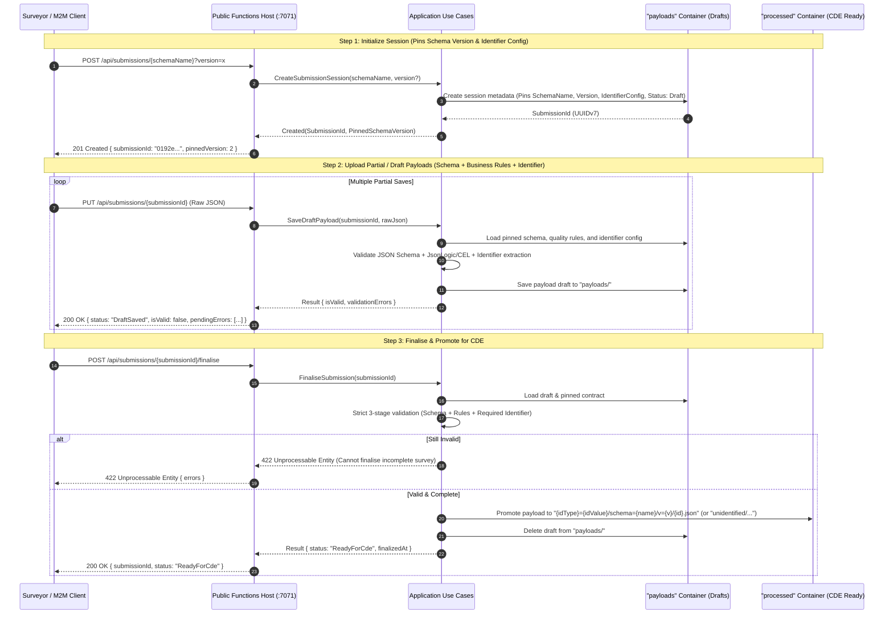

# Estate Data Collection (EDC) Service

Data ingestion, dynamic contract governance, and regression testing platform for the **Department for Education (DfE) Education Estates Directorate (EED)**.

The service evaluates incoming survey and estate payloads against versioned **JSON Schema (Draft 2020-12 / Draft-07)** and **ODCS v3.2.0 YAML** contracts with attached **JsonLogic** and **CEL** business quality rules, performs configurable **schema-verified establishment identifier extraction** (`URN`, `LAEstab`, `UKPRN`, custom pointer, or omitted), orchestrates draft and finalised submissions across dedicated Azure Blob Storage containers (`schemas`, `draft-schemas`, `payloads`, `processed`), and provides a **DfE / GOV.UK Design System SSR Admin Portal** for contract verification, lifecycle scheduling, and automated regression test execution.

For full architectural deep-dives and design decisions, see:
- [System Architecture Guide](ARCHITECTURE.md)
- [Architecture Decision Records (ADRs)](docs/DECISIONS.md) (including [ADR 0022: Authoring Schema Test Fixtures & Expected Errors](docs/decisions/0022-authoring-schema-test-fixtures-and-expected-errors.md))
- [Deployment & Operations Guide](docs/DEPLOYMENT.md)

## Solution Topology

The solution splits responsibilities cleanly across Clean Architecture layers and two isolated **.NET 10 Azure Functions** hosts plus an SSR UI Razor Class Library:

| Project | Role | Default Local Port |
| :--- | :--- | :--- |
| `src/EstateDataCollection.Domain` | Core entities (`SchemaMetadata`, `SubmissionSession`, `SubmissionIdentifier`, `SchemaIdentifierConfig`, `InvalidFixtureParser`) and invariants | — |
| `src/EstateDataCollection.Application` | `IUseCase<TResult, TRequest>` handlers (`GetSchemas`, `GetSchemaDetail`, `VerifySchema`, `SubmitSchema`, `ScheduleSchema`, `IngestDraftSchema`, `UpdateSchemaTests`, `RunSchemaTests`, `CreateSubmission`, `UpdateSubmission`, `FinaliseSubmission`) | — |
| `src/EstateDataCollection.Infrastructure` | `JsonSchema.Net`, `OdcsContractParser`, `JsonLogic` & `CEL` engines, `IdentifierSchemaValidator`, and Azure Blob Storage repositories | — |
| `src/EstateDataCollection.Common` & `Common.Web` | `Result<T>`, `Error`, CalVer `AppVersionProvider`, Scrutor registration, `FunctionEndpointBase`, and worker middleware | — |
| `src/EstateDataCollection.Admin.UI` | Server-Side Rendered GOV.UK / DfE Razor pages, components, **Zero-Logic Presentation ViewModels**, and embedded static assets | — |
| `src/EstateDataCollection.AzureFunctions.Public` | Public M2M ingestion and schema discovery API (`/api/schemas*` active-by-default with `includeUpcoming`/`includeRetired` filters, `/api/submissions*`, `/api/about`) | `http://localhost:7071` |
| `src/EstateDataCollection.AzureFunctions.Admin` | Unified Admin API (`/api/schemas*`, `/api/schemas/verify`, `/api/schemas/tests/run`), SSR Admin Portal (`/manage`, `/manage/workbench`, `/manage/schemas/{name}/{v}/tests`, `/assets/*`), & Event Grid draft ingestion (`IngestDraftSchemaEvent`, dual YAML/JSON with JSON precedence) | `http://localhost:7072` |

## Architecture Flow



## Admin Portal & Schema Regression Testing

Navigate to **`http://localhost:7072/manage`** when running `EstateDataCollection.AzureFunctions.Admin`:

- **Schema Catalogue Dashboard (`/manage`)**: Displays schema families, version lifecycle tags (`Draft`, `Validated`, `Scheduled`, `Active`, `Deprecated`, `Retired`), **last regression test run state** (`Passed`, `Passed (warnings)`, `Failed`, `Not run` + UTC timestamp) on every version card, and a one-click **Run All Schema Tests** button.
- **Contract Workbench (`/manage/workbench`)**: Dry-run verify or ingest **ODCS v3.2.0 YAML** or **JSON Schema + JsonLogic/CEL rules**, auto-discover scalar identifier properties from the contract AST (`URN`, `LAEstab`, `UKPRN`, custom pointer, or `None`), and test candidate valid/invalid fixtures before saving.
- **Schema Detail (`/manage/schemas/{name}/{version}/details`) & Lifecycle Scheduling (`.../schedule`)**: Inspect extracted field trees, rule definitions, raw schema JSON, identifier settings, and manage Effective From / Effective To windows.
- **Stored Regression Test Suite Editor (`.../tests`)**: View stored `v{version}.valid.json` and `v{version}.invalid.json` fixtures, see triggered rule/schema/identifier diagnostics, configure strict `"expectedErrors"` assertions (with non-blocking `"Failed — unknown if expected"` soft warnings for legacy bare payloads), edit/save fixtures without mutating the immutable schema, and execute per-version test runs.
- **Zero-Logic Razor Architecture ([ADR 0018](docs/decisions/0018-zero-logic-razor-views-and-presentation-viewmodels.md))**: All `.razor` pages and GOV.UK components are purely declarative; formatting, CSS class resolution, error binding, and visibility flags live in `Models/ViewModels/*.cs`.

## Observability, Logging & Instrumentation

The solution implements zero-allocation structured logging using compile-time `[LoggerMessage]` source generators and OpenTelemetry:

```mermaid
flowchart TD
    App[Application Use Cases] -->|Typed Calls| IInst[IInstrumentation Classes]
    Infra[Infrastructure Adapters] -->|Typed Calls| IInst
    Routes[Function HTTP & Event Routes] -->|Typed Calls| IInst

    IInst -->|[LoggerMessage] Source Generator| MSLog[Microsoft.Extensions.Logging]

    MSLog --> Console[Console / Terminal Stream]
    MSLog --> OTEL[OpenTelemetry SDK]
    MSLog --> AppInsights[Application Insights Worker Service]

    OTEL -->|Traces & Metrics| AzureMon[Azure Monitor / App Insights]
    OTEL -->|OTLP Exporter| Aspire[OTLP Collector / Aspire Dashboard]
```

### 1. `IInstrumentation` Pattern
- **Marker Interface**: All instrumentation classes implement `IInstrumentation` (`EstateDataCollection.Common.Markers.IInstrumentation`) and are registered automatically via Scrutor.
- **Zero-Allocation Logging**: Includes instrumentation for use cases (`VerifySchema`, `SubmitSchema`, `ScheduleSchema`, `IngestDraftSchema`, `UpdateSchemaTests`, `RunSchemaTests`, `CreateSubmission`, `UpdateSubmission`, `FinaliseSubmission`), infrastructure (`BlobSchemaRegistry`, `BlobSubmissionInfrastructure`, `JsonSchemaNetValidator`, `OdcsContractParser`, `JsonLogicValidator`), and shared HTTP endpoints (`FunctionEndpointInstrumentation`).

### 2. Shared Web Host Setup (`EstateDataCollection.Common.Web`)
- [`DependencyInjection.AddLogging`](src/EstateDataCollection.Common.Web/DependencyInjection.cs#L48-L85) configures console logging (`Information`), removes the default Application Insights `< Warning` filter suppression, optionally binds Azure App Configuration, and wires `ConfigureFunctionsApplicationInsights()`.
- `UseFunctionsMiddleware()` registers `RequestSizeLimitMiddleware`, `GlobalExceptionMiddleware`, and `VersionLoggingMiddleware` (stamping CalVer `service.version` onto request log scopes and traces).

## Local Development Setup

### 1. Prerequisites
- **.NET 10 SDK**
- **Azure Functions Core Tools v4** (`brew install azure-functions-core-tools@4` on macOS)
- **Docker** (for Azurite local storage emulator)
- **Azure CLI** (optional, for cloud deployments)

### 2. Running Azurite with Docker

Launch Azurite exposing the default ports:

```bash
docker run -d -p 10000:10000 -p 10001:10001 -p 10002:10002 \
  --name azurite \
  mcr.microsoft.com/azure-storage/azurite
```

Create the four local containers (`schemas`, `draft-schemas`, `payloads`, `processed`):

```bash
AZURITE_CONN="DefaultEndpointsProtocol=http;AccountName=devstoreaccount1;AccountKey=Eby8vdM02xNOcqFlqUwJPLlmEtlCDXJ1OUzFT50uSRZ6IFsuFq2UVErCz4I6tq/K1SZFPTOtr/KBHBeksoGMGw==;BlobEndpoint=http://127.0.0.1:10000/devstoreaccount1;"

az storage container create --name schemas --connection-string "$AZURITE_CONN"
az storage container create --name draft-schemas --connection-string "$AZURITE_CONN"
az storage container create --name payloads --connection-string "$AZURITE_CONN"
az storage container create --name processed --connection-string "$AZURITE_CONN"
```

### 3. Local Configuration (`local.settings.json`)

Copy each host's `local.settings.example.json` to `local.settings.json` (git-ignored):

```bash
cp src/EstateDataCollection.AzureFunctions.Public/local.settings.example.json src/EstateDataCollection.AzureFunctions.Public/local.settings.json
cp src/EstateDataCollection.AzureFunctions.Admin/local.settings.example.json src/EstateDataCollection.AzureFunctions.Admin/local.settings.json
```

### 4. Running Locally

Run either or both hosts in separate terminals:

```bash
# Public Ingestion & Schema Discovery API (http://localhost:7071/api)
func start --script-root src/EstateDataCollection.AzureFunctions.Public --port 7071

# Admin API (http://localhost:7072/api) & SSR Admin Portal UI (http://localhost:7072/manage)
func start --script-root src/EstateDataCollection.AzureFunctions.Admin --port 7072
```

### 5. Running Automated Tests

Run the full automated solution suite (Unit + isolated Azurite Integration tests):

```bash
dotnet test EstateDataCollection.slnx
```

> **Storage Isolation ([ADR 0021](docs/decisions/0021-isolated-ephemeral-azurite-test-containers.md)):** `AzuriteFixture` connects to the running Azurite instance (`AZURE_STORAGE_CONNECTION_STRING`, `ConnectionStrings__BlobStorage`, or default `127.0.0.1:10000` — local Docker, Dev Container, or CI service container), executes integration tests inside unique `test-{runId}-*` containers, and deletes them on teardown—leaving local development containers untouched.

### 6. Testing with the `.http` File

Use [EstateDataCollection.Admin.http](src/EstateDataCollection.AzureFunctions.Admin/EstateDataCollection.Admin.http) or [EstateDataCollection.http](src/EstateDataCollection.AzureFunctions.Public/EstateDataCollection.http) directly inside JetBrains Rider or VS Code (REST Client) to walk through:
1. ODCS YAML / JSON Schema verification & JsonLogic/CEL quality rules verification.
2. Schema submission, lifecycle scheduling (`Schedule` / `Activate` / `Deprecate` / `Retire`), and identifier config (`URN`, `LAEstab`, `None`).
3. Two-step survey submission sessions, draft saves, and promotion to `processed/`.

## Azure App Configuration Setup (Shared & Initial Keys)

Both `EstateDataCollection.AzureFunctions.Public` and `EstateDataCollection.AzureFunctions.Admin` share a single centralised configuration model ([ADR 0007](docs/decisions/0007-centralised-configuration-and-strongly-typed-options.md)) wired via [`AzureAppConfigurationExtensions.AddAppConfiguration`](src/EstateDataCollection.Infrastructure/Configuration/AzureAppConfigurationExtensions.cs) and validated at startup via [`ConfigOptionsExtensions.AddConfigOptions`](src/EstateDataCollection.Infrastructure/Configuration/ConfigOptionsExtensions.cs).

### 1. Host Bootstrap Environment Variables

Set these on each Function App (or in `local.settings.json` / shell when testing against cloud App Configuration) so the host can authenticate and connect before loading remote keys:

| Variable | Required | Purpose | Example |
| :--- | :--- | :--- | :--- |
| `AZURE_APPCONFIGURATION_ENDPOINT` | Yes (to enable App Config) | Store URI (also accepts `AZURE_APP_CONFIGURATION_ENDPOINT` or `EDC_APPCONFIG_ENDPOINT`) | `https://appcs-edc-dev.azconfig.io` |
| `AZURE_CLIENT_ID` | Only for User-Assigned MI | Client ID passed to `DefaultAzureCredential` when not using System-Assigned MI | `00000000-0000-0000-0000-000000000000` |
| `AZURE_FUNCTIONS_ENVIRONMENT` | Recommended | Environment tag stamped on `/api/about`, logs, and `service.environment` | `Development` / `Test` / `Production` |

> [!NOTE]
> `AddAppConfiguration` authenticates using `DefaultAzureCredential`, loads unlabeled keys (`KeyFilter: *`, `LabelFilter: Null`), resolves Azure Key Vault references with the same credential, and watches `Edc:Sentinel` every **5 minutes** (`refreshAll: true`). Ensure each Function App's Managed Identity has **App Configuration Data Reader** on the store (and **Key Vault Secrets User** for referenced secrets).

### 2. Shared & Initial App Configuration Key-Values

All keys below are shared across both the **Public** and **Admin** hosts. Default values in code are shown so you only need to seed overrides or environment-specific values, though seeding the full initial set makes configuration explicit and dynamically tunable via `Edc:Sentinel`.

#### Sentinel & Shared Infrastructure / Telemetry

| Key | Type / Format | Initial / Default Value | Notes |
| :--- | :--- | :--- | :--- |
| `Edc:Sentinel` | String | `1` | Increment/change to trigger a 5-minute `refreshAll` reload across hosts |
| `EDC_STORAGE_BLOB_ENDPOINT` | URI | - | Preferred Managed Identity blob endpoint (or set `EDC_STORAGE_ACCOUNT_NAME` or `ConnectionStrings:BlobStorage`) |
| `APPLICATIONINSIGHTS_CONNECTION_STRING` | Key Vault Ref / String | *(Key Vault secret reference)* | Application Insights telemetry connection string |
| `APPLICATIONINSIGHTS_INCLUDE_VERSION` | Boolean | `false` | Set `true` to append `:<version>` to the OpenTelemetry `service.name` |
| `OTEL_EXPORTER_OTLP_ENDPOINT` | URI (Optional) | *(Leave unset in Azure)* | OTLP gRPC collector endpoint (used primarily for local dev, e.g. `http://localhost:18889`) |

#### Schema Registry (`Blob:Schema` — [`BlobSchemaRegistryOptions`](src/EstateDataCollection.Infrastructure/Registry/BlobSchemaRegistryOptions.cs))

| Key | Initial / Default Value |
| :--- | :--- |
| `Blob:Schema:ContainerName` | `schemas` |
| `Blob:Schema:DraftContainerName` | `draft-schemas` |
| `Blob:Schema:DraftErrorBlobSuffix` | `.error.json` |
| `Blob:Schema:CacheKey` | `schema:{schemaName}:v{version}` |
| `Blob:Schema:SchemaBlobDirectory` | `{schemaName}/v{version}.schema.json` |
| `Blob:Schema:MetaBlobDirectory` | `{schemaName}/v{version}.meta.json` |
| `Blob:Schema:RulesBlobDirectory` | `{schemaName}/v{version}.rules.json` |
| `Blob:Schema:LogicBlobDirectory` | `{schemaName}/v{version}.logic.json` |
| `Blob:Schema:OdcsBlobDirectory` | `{schemaName}/v{version}.odcs.yaml` |
| `Blob:Schema:ValidFixturesBlobDirectory` | `{schemaName}/v{version}.valid.json` |
| `Blob:Schema:InvalidFixturesBlobDirectory` | `{schemaName}/v{version}.invalid.json` |

#### Submission Landing Zone (`Blob:Submission` — [`BlobSubmissionRepositoryOptions`](src/EstateDataCollection.Infrastructure/Persistence/BlobSubmissionRepositoryOptions.cs))

| Key | Initial / Default Value |
| :--- | :--- |
| `Blob:Submission:PayloadContainerName` | `payloads` |
| `Blob:Submission:ProcessedContainerName` | `processed` |
| `Blob:Submission:SessionBlobNameFormat` | `{submissionId}/session.json` |
| `Blob:Submission:PayloadBlobNameFormat` | `{submissionId}/draft.json` |
| `Blob:Submission:DraftBlobPrefixFormat` | `{submissionId}/drafts/` |
| `Blob:Submission:AuditBlobPrefixFormat` | `{submissionId}/audit/` |
| `Blob:Submission:ProcessedBlobNameFormat` | `urn={urn}/schema={schemaName}/v={schemaVersion}/{submissionId}.json` |

#### Request Security (`Security:RequestSizeLimit` — [`RequestSizeLimitOptions`](src/EstateDataCollection.Common.Web/Models/Options/RequestSizeLimitOptions.cs))

| Key | Initial / Default Value | Constraints |
| :--- | :--- | :--- |
| `Security:RequestSizeLimit:MaxSizeMb` | `15` | Integer between `1` and `100` |

#### Dynamic Validation & Rule Engines (`Validation` — [`ValidationOptions`](src/EstateDataCollection.Application/Models/Options/ValidationOptions.cs))

| Key | Initial / Default Value | Notes |
| :--- | :--- | :--- |
| `Validation:EnabledEngines:0` | `jsonlogic` | Indexed array (`0`, `1`, …) of enabled rule engines |
| `Validation:EnabledEngines:1` | `cel` | |
| `Validation:DefaultEngine` | `jsonlogic` | Engine used when a rule omits `engine` |
| `Validation:UnknownEngineBehavior` | `Fail` | `Fail` or `Skip` |
| `Validation:RunQualityRulesOnDraftUpdate` | `true` | Evaluates JsonLogic/CEL on `PUT /api/submissions/{id}` |
| `Validation:ValidateIdentifierOnDraftUpdate` | `true` | Checks establishment identifier extraction during draft saves |
| `Validation:TreatWarningsAsErrors` | `false` | Promotes `Severity = "WARNING"` rule findings to blocking errors |
| `Validation:RequireFormatValidation` | `true` | Enforces JSON Schema `format` annotations (`email`, `date-time`, etc.) |
| `Validation:RequireUrnOnFinalise` | `true` | Default identifier requirement when a schema omits explicit `IdentifierConfig` |
| `Validation:UrnJsonPaths:0` | `school.urn` | Fallback JSON paths searched when no explicit `JsonPointer` is configured |
| `Validation:UrnJsonPaths:1` | `urn` | |
| `Validation:CelMaxIterations` | `10000` | Maximum loop/comprehension iterations per CEL evaluation |
| `Validation:AllowedMetaSchemas:0`..`:5` | Draft `2020-12` & `draft-07` URIs | See [`ValidationOptions.cs`](src/EstateDataCollection.Application/Models/Options/ValidationOptions.cs#L57-L65) for the 6 default URIs |

### 3. Initial JSON Import Template

To seed a new Azure App Configuration store in one step (e.g. via **Configuration explorer → Import/Export → JSON** or `az appconfig kv import --separator ":" --format json`), save and import the following initial template after replacing the environment placeholders:

```json
{
  "Edc": {
    "Sentinel": "1"
  },
  "EDC_STORAGE_BLOB_ENDPOINT": "",
  "APPLICATIONINSIGHTS_INCLUDE_VERSION": false,
  "Blob": {
    "Schema": {
      "ContainerName": "schemas",
      "DraftContainerName": "draft-schemas",
      "DraftErrorBlobSuffix": ".error.json",
      "CacheKey": "schema:{schemaName}:v{version}",
      "SchemaBlobDirectory": "{schemaName}/v{version}.schema.json",
      "MetaBlobDirectory": "{schemaName}/v{version}.meta.json",
      "RulesBlobDirectory": "{schemaName}/v{version}.rules.json",
      "LogicBlobDirectory": "{schemaName}/v{version}.logic.json",
      "OdcsBlobDirectory": "{schemaName}/v{version}.odcs.yaml",
      "ValidFixturesBlobDirectory": "{schemaName}/v{version}.valid.json",
      "InvalidFixturesBlobDirectory": "{schemaName}/v{version}.invalid.json"
    },
    "Submission": {
      "PayloadContainerName": "payloads",
      "ProcessedContainerName": "processed",
      "SessionBlobNameFormat": "{submissionId}/session.json",
      "PayloadBlobNameFormat": "{submissionId}/draft.json",
      "DraftBlobPrefixFormat": "{submissionId}/drafts/",
      "AuditBlobPrefixFormat": "{submissionId}/audit/",
      "ProcessedBlobNameFormat": "urn={urn}/schema={schemaName}/v={schemaVersion}/{submissionId}.json"
    }
  },
  "Security": {
    "RequestSizeLimit": {
      "MaxSizeMb": 15
    }
  },
  "Validation": {
    "EnabledEngines": ["jsonlogic", "cel"],
    "DefaultEngine": "jsonlogic",
    "UnknownEngineBehavior": "Fail",
    "RunQualityRulesOnDraftUpdate": true,
    "ValidateIdentifierOnDraftUpdate": true,
    "TreatWarningsAsErrors": false,
    "RequireFormatValidation": true,
    "RequireUrnOnFinalise": true,
    "UrnJsonPaths": ["school.urn", "urn"],
    "CelMaxIterations": 10000,
    "AllowedMetaSchemas": [
      "https://json-schema.org/draft/2020-12/schema",
      "http://json-schema.org/draft/2020-12/schema",
      "http://json-schema.org/draft-07/schema#",
      "https://json-schema.org/draft-07/schema#",
      "http://json-schema.org/draft-07/schema",
      "https://json-schema.org/draft-07/schema"
    ]
  }
}
```

## Azure Deployment (Flex Consumption)

See the complete guide in [docs/DEPLOYMENT.md](docs/DEPLOYMENT.md) and [ADR 0006](docs/decisions/0006-flex-consumption-self-contained-deployment.md).

- **Self-contained `linux-x64` packages:** Published via `.github/actions/setup-and-test/action.yml` for `EstateDataCollection.AzureFunctions.Public` (`edc-functions-public-linux-x64.zip`) and `EstateDataCollection.AzureFunctions.Admin` (`edc-functions-admin-linux-x64.zip`), which includes both the Admin API and SSR Admin Portal.
- **`FUNCTIONS_WORKER_RUNTIME`:** Do **not** set in Flex Consumption App Settings (managed at the platform `functionAppConfig` runtime level).
- **Storage auth:** Supports Managed Identity (`AzureWebJobsStorage__accountName`, `BlobStorageOptions__ServiceUri`) or connection strings (`ConnectionStrings__BlobStorage`).
