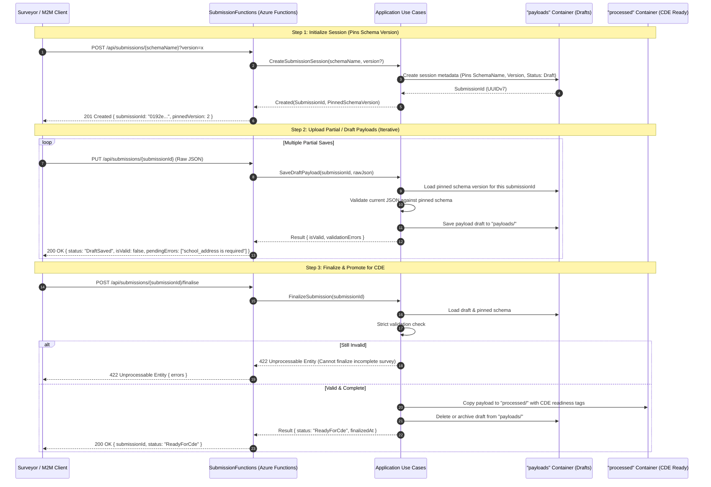

# Estate Data Collection (EDC) Service

Machine-to-machine data ingestion platform for the Department for Education (DfE) Education Estates Directorate (EED). 
The service evaluates incoming condition surveys against dynamic JSON Schema contracts, manages draft upload sessions, maintains an append-only document cache, and orchestrates contracts and payloads across dedicated Blob Storage containers (`schemas`, `payloads`, `processed`), preparing for downstream Common Data Environment (CDE) injection.

For full architectural deep-dives and design decisions, see:
- 📖 [**System Architecture Guide**](ARCHITECTURE.md)
- 🏛️ [**Architecture Decision Records (ADRs)**](docs/decisions/DECISIONS.md)

---

## Architecture Flow



---

## Observability, Logging & Instrumentation

The solution implements a zero-allocation, high-performance structured logging architecture using compile-time source-generated loggers and OpenTelemetry:

```mermaid
flowchart TD
    App[Application Use Cases] -->|Typed Calls| IInst[IInstrumentation Classes]
    Infra[Infrastructure Adapters] -->|Typed Calls| IInst
    Routes[Function HTTP Routes] -->|Typed Calls| IInst

    IInst -->|[LoggerMessage] Source Generator| MSLog[Microsoft.Extensions.Logging]
    
    MSLog --> Console[Console / Terminal Stream]
    MSLog --> OTEL[OpenTelemetry SDK]
    MSLog --> AppInsights[Application Insights Worker Service]

    OTEL -->|Traces & Metrics| AzureMon[Azure Monitor / App Insights]
    OTEL -->|OTLP Exporter| Aspire[OTLP Collector / Aspire Dashboard]
```

### 1. `IInstrumentation` Pattern
- **Marker Interface**: All instrumentation classes implement `IInstrumentation` (`EstateDataCollection.Common.Markers.IInstrumentation`).
- **Automatic Registration**: Scrutor scans and registers all `IInstrumentation` implementations as transient dependencies (`services.AddClasses(c => c.AssignableTo<IInstrumentation>()).AsSelf().WithTransientLifetime()`).
- **Zero-Allocation Logging**: Methods use C# compile-time `[LoggerMessage]` source generators:
  - `VerifySchemaUseCaseInstrumentation`
  - `SubmitSchemaUseCaseInstrumentation`
  - `CreateSubmissionUseCaseInstrumentation`
  - `UpdateSubmissionUseCaseInstrumentation`
  - `FinaliseSubmissionUseCaseInstrumentation`
  - `BlobSchemaRegistryInstrumentation`
  - `BlobSubmissionInfrastructureInstrumentation`
  - `JsonSchemaNetValidatorInstrumentation`
  - `SchemaFunctionsInstrumentation`
  - `SubmissionFunctionsInstrumentation`

### 2. Logging & Host Configuration
- **`host.json`**: Configures log levels for the Azure Functions Host runtime to prevent suppression of custom namespaces:
  ```json
  {
    "version": "2.0",
    "logging": {
      "applicationInsights": {
        "samplingSettings": {
          "isEnabled": true,
          "excludedTypes": "Request"
        }
      },
      "logLevel": {
        "default": "Information",
        "Function": "Information",
        "Host.Results": "Information",
        "Host.Aggregator": "Information",
        "EstateDataCollection": "Information"
      }
    }
  }
  ```
- **`DependencyInjection.AddLogging`**: Centralised in `EstateDataCollection.AzureFunctions`:
  - Registers `logging.AddConsole()` and sets the minimum log level to `LogLevel.Information`.
  - Removes the default Application Insights filter that suppresses `< Warning` logs for custom categories.
  - Automatically configures `ConfigureFunctionsApplicationInsights()` if `APPLICATIONINSIGHTS_CONNECTION_STRING` is present.
  - Registers OpenTelemetry Tracing (`EstateDataCollection.*`, `Microsoft.Azure.Functions.Worker`) and Metrics.

---

## Local Development Setup

### 1. Prerequisites
- **.NET 10 SDK**
- **Azure Functions Core Tools v4** (`brew install azure-functions-core-tools@4` on macOS)
- **Docker** (for Azurite local storage emulator)
- **Azure CLI** (optional, for cloud deployments)

---

### 2. Running Azurite with Docker

Launch Azurite in Docker exposing the default ports:

```bash
docker run -d -p 10000:10000 -p 10001:10001 -p 10002:10002 \
  --name azurite \
  mcr.microsoft.com/azure-storage/azurite
```

#### Create Required Blob Containers
The application relies on three containers: `schemas`, `payloads`, and `processed`:

```bash
# Connection string for Azurite default emulator
AZURITE_CONN="DefaultEndpointsProtocol=http;AccountName=devstoreaccount1;AccountKey=Eby8vdM02xNOcqFlqUwJPLlmEtlCDXJ1OUzFT50uSRZ6IFsuFq2UVErCz4I6tq/K1SZFPTOtr/KBHBeksoGMGw==;BlobEndpoint=http://127.0.0.1:10000/devstoreaccount1;"

# Create the three required containers
az storage container create --name schemas --connection-string "$AZURITE_CONN"
az storage container create --name payloads --connection-string "$AZURITE_CONN"
az storage container create --name processed --connection-string "$AZURITE_CONN"
```

---

### 3. Local Configuration (`local.settings.json`)

The file `src/EstateDataCollection.AzureFunctions/local.settings.json` is pre-configured for local testing:

```json
{
  "IsEncrypted": false,
  "Values": {
    "AzureWebJobsStorage": "UseDevelopmentStorage=true",
    "FUNCTIONS_WORKER_RUNTIME": "dotnet-isolated",
    "AZURE_APPCONFIGURATION_ENDPOINT": "",
    "ConnectionStrings:BlobStorage": "UseDevelopmentStorage=true",
    "OTEL_EXPORTER_OTLP_ENDPOINT": "http://localhost:57382"
  },
  "Blob:Schema": {
    "ContainerName": "schemas",
    "CacheKey": "schema:{schemaName}:v{version}",
    "SchemaBlobDirectory": "{schemaName}/v{version}.schema.json",
    "MetaBlobDirectory": "{schemaName}/v{version}.meta.json"
  },
  "Blob:Submission": {
    "PayloadsContainerName": "payloads",
    "ProcessedContainerName": "processed",
    "DraftSessionBlobFormat": "{submissionId}/session.json",
    "DraftPayloadBlobFormat": "{submissionId}/draft.json",
    "ProcessedBlobFormat": "urn={urn}/schema={schemaName}/v={schemaVersion}/{submissionId}.json"
  }
}
```

---

### 4. Running Locally

```bash
cd src/EstateDataCollection.AzureFunctions
func start
```

The host will start on `http://localhost:7071/api`.

---

### 5. Running Automated Tests

Run the full automated test suite (60 unit and integration tests):

```bash
dotnet test
```

All test methods follow the human-readable behavioural naming pattern:
`When_Condition_It_Should_ExpectedBehavior`

---

### 6. Testing with the `.http` File

Use [EstateDataCollection.http](src/EstateDataCollection.AzureFunctions/EstateDataCollection.http) directly inside JetBrains Rider or VS Code (REST Client):

1. **Verify Candidate Schema**: Execute `1.1 Verify Schema Candidate` (tests Draft 2020-12 syntax and fixtures).
2. **Publish Schema v1**: Execute `1.2 Submit & Schedule Schema v1` to upload the contract into Azurite's `schemas` container.
3. **Start a Survey Session**: Execute `2.2 Create Submission Session` (creates session, pins v1, returns `submissionId`).
4. **Iterative Draft Uploads**: Execute `2.3` through `2.5` to test partial uploads with real-time JSON Schema validation feedback.
5. **Finalize**: Execute `2.7 Finalise Submission` to seal the survey and move it to `processed/` with `ReadyForCde`.

---

## Azure Deployment (Flex Consumption)

### Key Configuration Considerations
1. **`FUNCTIONS_WORKER_RUNTIME`**: On Azure Flex Consumption, do **not** define `FUNCTIONS_WORKER_RUNTIME` in Application Settings; it is managed at the platform site-config level.
2. **Storage Resolution**: Infrastructure supports connection strings (`AzureWebJobsStorage`, `DEPLOYMENT_STORAGE_CONNECTION_STRING`) or Managed Identity (`AzureWebJobsStorage__accountName`, `EDC_STORAGE_BLOB_ENDPOINT`).
3. **`.funcignore`**: Pre-configured to prevent local debug symbols, temporary files, and test outputs from inflating the deployment zip.

### Publishing to Azure

#### Method A: Self-Contained Linux Publish (Recommended for .NET 10 on Linux Flex Consumption)
Bundles the .NET 10 runtime directly into the deployment package to guarantee compatibility with Linux host images:

```bash
# 1. Publish self-contained for Linux x64
dotnet publish src/EstateDataCollection.AzureFunctions \
  -c Release \
  -r linux-x64 \
  --self-contained true \
  -o ./publish-out

# 2. Package and zip deploy via Azure CLI
cd ./publish-out && zip -r ../deploy.zip . && cd ..
az functionapp deployment source config-zip \
  -g s251d01rg-uks-EstateDataCollection \
  -n s251d01-edc-func \
  --src ./deploy.zip

# 3. Clean up build artifacts
rm -rf ./publish-out ./deploy.zip
```

#### Method B: Via Azure Functions Core Tools
```bash
cd src/EstateDataCollection.AzureFunctions
func azure functionapp publish s251d01-edc-func
```
