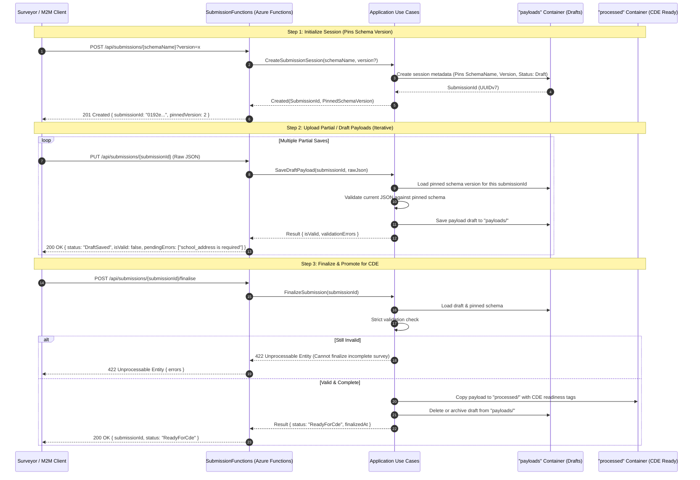

# Estate Data Collection (EDC) Service

Machine-to-machine data ingestion platform for the Department for Education (DfE) Education Estates Directorate (EED). 
The service evaluates incoming condition surveys against dynamic JSON Schema contracts, manages file upload landing zones, maintains an append-only document cache, and manages contracts and payloads across dedicated Blob Storage containers (`schemas`, `payloads`, `processed`), preparing for downstream CDE injection.

---

## Architecture Flow



---

## Local Development Setup

### 1. Prerequisites
- **.NET 10 SDK**
- **Azure Functions Core Tools v4** (`brew install azure-functions-core-tools@4` on macOS)
- **Docker** (for Azurite local storage emulator)
- **Azure CLI** (optional, for creating containers)

---

### 2. Running Azurite with Docker

If you do not have Azurite running yet, launch it in Docker exposing the default ports:

```bash
docker run -d -p 10000:10000 -p 10001:10001 -p 10002:10002 \
  --name azurite \
  mcr.microsoft.com/azure-storage/azurite
```

#### Create Required Blob Containers
The application relies on three containers: `schemas`, `payloads`, and `processed`. You can create them automatically via the Azure CLI against your Azurite instance:

```bash
# Connection string for Azurite default emulator
AZURITE_CONN="DefaultEndpointsProtocol=http;AccountName=devstoreaccount1;AccountKey=Eby8vdM02xNOcqFlqUwJPLlmEtlCDXJ1OUzFT50uSRZ6IFsuFq2UVErCz4I6tq/K1SZFPTOtr/KBHBeksoGMGw==;BlobEndpoint=http://127.0.0.1:10000/devstoreaccount1;"

# Create the three required containers
az storage container create --name schemas --connection-string "$AZURITE_CONN"
az storage container create --name payloads --connection-string "$AZURITE_CONN"
az storage container create --name processed --connection-string "$AZURITE_CONN"
```

*(Alternatively, use **Azure Storage Explorer** connected to `http://127.0.0.1:10000/devstoreaccount1` to right-click and create `schemas`, `payloads`, and `processed`).*

---

### 3. Local Configuration (`local.settings.json`)

The `src/EstateDataCollection.AzureFunctions/local.settings.json` file is pre-configured to bind directly to Azurite:

```json
{
  "IsEncrypted": false,
  "Values": {
    "AzureWebJobsStorage": "UseDevelopmentStorage=true",
    "FUNCTIONS_WORKER_RUNTIME": "dotnet-isolated",
    "ConnectionStrings:BlobStorage": "UseDevelopmentStorage=true"
  },
  "Blob:Schema": {
    "ContainerName": "schemas",
    "CacheKey": "schema:{schemaName}:v{version}",
    "SchemaBlobDirectory": "{schemaName}/v{version}.schema.json",
    "MetaBlobDirectory": "{schemaName}/v{version}.meta.json"
  },
  "Blob:Submission": {
    "PayloadsContainerName": "payloads",
    "ProcessedContainerName": "processed",
    "DraftSessionBlobFormat": "{submissionId}/session.json",
    "DraftPayloadBlobFormat": "{submissionId}/draft.json",
    "ProcessedBlobFormat": "urn={urn}/schema={schemaName}/v={schemaVersion}/{submissionId}.json"
  }
}
```

---

### 4. Running the Functions Host Locally

#### Option A: Via Command Line
Navigate to the Azure Functions project folder and run:

```bash
cd src/EstateDataCollection.AzureFunctions
func start
```

The host will start on `http://localhost:7071/api`.

#### Option B: Via JetBrains Rider / Visual Studio
1. Open `EstateDataCollection.slnx`.
2. Select the **EstateDataCollection.AzureFunctions** run configuration.
3. Click **Run** or **Debug** (`F5`).

---

### 5. Testing with the `.http` File

Use [EstateDataCollection.http](EstateDataCollection.http) directly inside JetBrains Rider or VS Code (REST Client):

1. **Verify Candidate Schema**: Execute `1.1 Verify Schema Candidate` (tests Draft 2020-12 syntax and fixtures).
2. **Publish Schema v1**: Execute `1.2 Submit & Schedule Schema v1` to upload the contract into Azurite's `schemas` container.
3. **Start a Survey Session**: Execute `2.2 Create Submission Session` (creates session, pins v1, returns `submissionId`).
4. **Iterative Draft Uploads**: Execute `2.3` through `2.5` to test partial uploads with real-time JSON Schema validation feedback.
5. **Finalize**: Execute `2.7 Finalise Submission` to seal the survey and move it to `processed/` with `ReadyForCde`.
