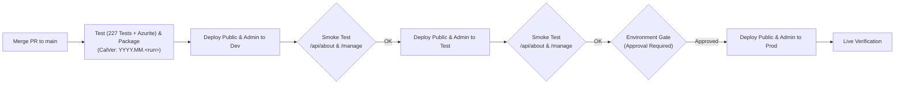

# Deployment Guide

This document is the authoritative guide for building, packaging, deploying, and verifying the **Estate Data Collection (EDC)** Azure Functions platform across all environments (**Dev**, **Test**, and **Prod**).

## Architectural Overview

The EDC platform operates on **Azure Functions v4 (Isolated Worker Model)** targeting **.NET 10** hosted on **Azure Functions Flex Consumption (Linux)** across segregated host applications:

| Deployable Host Project | Responsibility | Artifact Name |
| :--- | :--- | :--- |
| `src/EstateDataCollection.AzureFunctions.Public` | Public M2M survey ingestion & active schema discovery API (`/api/schemas*`, `/api/submissions*`, `/api/about`) | `edc-functions-public-linux-x64.zip` |
| `src/EstateDataCollection.AzureFunctions.Admin` | Unified Admin contract governance API (`/api/schemas*`, `/api/schemas/verify`, `/api/schemas/tests/run`), SSR Admin Portal (`/manage/*`, `/assets/*`), & Event Grid draft ingestion | `edc-functions-admin-linux-x64.zip` |

```
┌────────────────────────────────────────────────────────────────────────┐
│ GitHub Actions / Azure CLI                                             │
│   │                                                                    │
│   ├──> Run automated tests (Unit + isolated Azurite Integration)       │
│   ├──> dotnet publish -c Release -r linux-x64 --self-contained true    │
│   ├──> Exclude local.settings.json, *.http, *.pdb                      │
│   └──> Package Public & Admin Linux x64 zips                           │
│                                                                        │
│ Azure Cloud (Flex Consumption / Linux)                                 │
│   │                                                                    │
│   ├──> Azure App Service Zip Deploy (az functionapp deployment source) │
│   ├──> Entra ID OIDC CI/CD + Easy Auth for Admin Portal (/manage/*)    │
│   └──> Managed Identity accessing schemas, draft-schemas, payloads,    │
│        and processed Blob Storage containers                           │
└────────────────────────────────────────────────────────────────────────┘
```

### Key Principles

- **Self-Contained Linux x64 Deployment ([ADR 0006](decisions/0006-flex-consumption-self-contained-deployment.md))**:
  Because Azure Functions Flex Consumption hosts run on Linux containers without guaranteed pre-installed .NET 10 runtimes, all deployment bundles are published with `-r linux-x64 --self-contained true`.
- **Build Once, Deploy Many ([ADR 0014](decisions/0014-segregated-multi-workflow-ci-cd-with-composite-actions.md))**:
  Binaries are compiled and verified once in CI, generating immutable zip artifacts (`edc-functions-public-linux-x64.zip` and `edc-functions-admin-linux-x64.zip`) promoted sequentially across Dev $\to$ Test $\to$ Prod.
- **Sanitised Packages**:
  Local dev settings (`local.settings.json`), REST client files (`*.http`), and symbol files (`*.pdb`) are strictly excluded from all deployable packages.
- **Unified Admin Host (`"routePrefix": ""`)**:
  `AzureFunctions.Admin` serves both the Admin JSON API (`/api/*` with `AuthorizationLevel.Function`) and the SSR Admin Portal (`/manage/*`, `/assets/*` with `AuthorizationLevel.Anonymous`) in a single Function App.

## Environment Topology

The platform is partitioned into three distinct Azure environments:

| Environment | GitHub Environment Name | Purpose | Deployment Gate |
| :--- | :--- | :--- | :--- |
| **Development** | `Dev` | Integration testing & active development | Automated on merge to `main` |
| **Test** | `Test` | QA, automated integration, stakeholder sign-off | Automated promotion after Dev verification (or gated until provisioned) |
| **Production** | `Prod` | Live operational workload | **Manual Review Required** (GitHub Environment Gate) |

---

## Deployment Options

### Option A: Automated Multi-Environment CI/CD (Recommended)

Continuous Delivery is driven by [`.github/workflows/cd-main.yml`](file:///.github/workflows/cd-main.yml) using [`.github/actions/setup-and-test/action.yml`](file:///.github/actions/setup-and-test/action.yml) and [`.github/actions/deploy-function/action.yml`](file:///.github/actions/deploy-function/action.yml).



1. **Trigger**: Automatically runs whenever a pull request is merged into `main`.
2. **Process**:
   - Computes CalVer (`YYYY.MM.<run_number>`, e.g., `2026.11.42`).
   - Runs all **227** unit and integration tests against an Azurite service container (each run executes inside isolated `test-{runId}-*` containers per [ADR 0021](decisions/0021-isolated-ephemeral-azurite-test-containers.md)).
   - Builds and zips `edc-functions-public-linux-x64.zip` and `edc-functions-admin-linux-x64.zip`.
   - Deploys to **Dev** via Entra ID OIDC and checks `/api/about` (Public) and `/manage` (Admin).
   - Promotes the exact artifacts to **Test**, then waits at the **Prod** approval gate.

### Option B: On-Demand / Historical SHA Deployment

For emergency hotfixes, rollbacks, or deploying a specific commit to `Dev`, `Test`, or `Prod`, use [`.github/workflows/deploy-by-sha.yml`](file:///.github/workflows/deploy-by-sha.yml):

1. Navigate to **GitHub** $\to$ **Actions** $\to$ **CD: Deploy by Commit SHA**.
2. Click **Run workflow**, supply `commit_sha` (7–40 characters) and `target_environment`.

### Option C: Manual CLI Zip Deploy (`az CLI`)

To package and deploy the Function App hosts manually:

```bash
# 1. Navigate to the repository root
cd /path/to/estate-data-collection

# 2. Publish and zip Public and Admin for Linux x64
for APP in Public Admin; do
  rm -rf "./publish-$APP" "./edc-functions-$APP.zip"
  dotnet publish "src/EstateDataCollection.AzureFunctions.$APP/EstateDataCollection.AzureFunctions.$APP.csproj" \
    -c Release \
    -r linux-x64 \
    --self-contained true \
    -o "./publish-$APP"

  (cd "./publish-$APP" && zip -r "../edc-functions-$APP.zip" . -x "local.settings.json" "*.http" "*.pdb")
done

# 3. Deploy via Azure CLI
az login
az account set --subscription "<AZURE_SUBSCRIPTION_ID>"

az functionapp deployment source config-zip \
  --resource-group "<RESOURCE_GROUP_NAME>" \
  --name "<PUBLIC_FUNCTION_APP_NAME>" \
  --src "./edc-functions-Public.zip"

az functionapp deployment source config-zip \
  --resource-group "<RESOURCE_GROUP_NAME>" \
  --name "<ADMIN_FUNCTION_APP_NAME>" \
  --src "./edc-functions-Admin.zip"

# 4. Clean up local build artifacts
rm -rf ./publish-Public ./publish-Admin ./edc-functions-*.zip
```

### Option D: Azure Functions Core Tools (`func`)

> [!CAUTION]
> `func azure functionapp publish` builds against the workstation's native OS/architecture unless overridden. On macOS ARM64 or Windows, prefer **Option A**, **B**, or **C** when targeting Linux Flex Consumption.

---

## Zero-Trust Security & Authentication

### 1. CI/CD Deployment Auth (Entra ID OIDC)

Deployments authenticate via **OpenID Connect (OIDC)** federated credentials—no stored client secrets or publish profiles:

| Environment | GitHub Federated Credential Subject Format |
| :--- | :--- |
| **Dev** | `repo:<org>/<repo>:environment:Dev` *(or `repo:<org>@<owner_id>/<repo>@<repo_id>:environment:Dev` with immutable subjects)* |
| **Test** | `repo:<org>/<repo>:environment:Test` *(or `repo:<org>@<owner_id>/<repo>@<repo_id>:environment:Test` with immutable subjects)* |
| **Prod** | `repo:<org>/<repo>:environment:Prod` *(or `repo:<org>@<owner_id>/<repo>@<repo_id>:environment:Prod` with immutable subjects)* |

### 2. Required GitHub Environment Variables & Secrets

| Type | Name | Example Value | Description |
| :--- | :--- | :--- | :--- |
| **Secret** | `AZURE_CLIENT_ID` | `00000000-0000-0000-0000-000000000000` | Entra ID App (Client) ID |
| **Secret** | `AZURE_TENANT_ID` | `00000000-0000-0000-0000-000000000000` | Entra ID Tenant ID |
| **Secret** | `AZURE_SUBSCRIPTION_ID` | `00000000-0000-0000-0000-000000000000` | Target Azure Subscription ID |
| **Variable** | `AZURE_RESOURCE_GROUP` | `rg-edc-prod` | Azure Resource Group name |
| **Variable** | `AZURE_PUBLIC_FUNCTION_APP_NAME` | `func-edc-public-prod` | Public Function App name |
| **Variable** | `AZURE_ADMIN_FUNCTION_APP_NAME` | `func-edc-admin-prod` | Admin Function App name |

### 3. Admin Portal Authentication (Microsoft Entra ID / Easy Auth)

`FunctionPageBase.ResolveSignedInUser` already parses `X-MS-CLIENT-PRINCIPAL-NAME` and `X-MS-CLIENT-PRINCIPAL` claims emitted by Azure App Service Authentication (Easy Auth):
- **Separate `AdminUi` host:** Enable single-tenant Entra ID Easy Auth (`/.auth/login/aad/callback`) restricting access via an assigned Entra Security Group / App Role; `AdminUi` forwards `x-functions-key` from Key Vault/App Settings to the internal `Admin` Function App.
- **Merged `Admin` + `AdminUi` host:** Configure Easy Auth with `AllowAnonymous` token validation plus worker route middleware so `/manage*` enforces Entra login & role claims while `/api/*` continues accepting `x-functions-key` (or Entra Bearer tokens) and `/assets/*` stays accessible for CSS/fonts.

---

## Required Environment Variables & Configuration

Configure these settings on Azure Function Apps (double underscore `__` represents `:` hierarchy on Linux):

| Setting Name | Scope | Purpose | Example / Default |
| :--- | :--- | :--- | :--- |
| `ASPNETCORE_ENVIRONMENT` | All | Environment profile | `Development` / `Test` / `Production` |
| `ConnectionStrings__BlobStorage` or `BlobStorageOptions__ServiceUri` | Public, Admin | Storage account connection string or Managed Identity blob endpoint | `https://<resource>.blob.core.windows.net` |
| `AZURE_APPCONFIGURATION_ENDPOINT` | Public, Admin | Optional Azure App Configuration endpoint | `https://<resource>.azconfig.io` |
| `APPLICATIONINSIGHTS_CONNECTION_STRING` | All | Azure Application Insights telemetry | `InstrumentationKey=...` |
| `Blob__Schema__ContainerName` | Public, Admin | Registered contracts, rules, fixtures & metadata container | `schemas` |
| `Blob__Schema__DraftContainerName` | Admin | Event Grid-watched draft dropzone container | `draft-schemas` |
| `Blob__Submission__PayloadContainerName` | Public | In-flight survey sessions & drafts container | `payloads` |
| `Blob__Submission__ProcessedContainerName` | Public | Finalised CDE-ready partitioned lake container | `processed` |

> [!IMPORTANT]
> On Azure Functions **Flex Consumption**, do **not** manually set `FUNCTIONS_WORKER_RUNTIME` in Application Settings—the runtime is configured at the platform `functionAppConfig` level ([ADR 0006](decisions/0006-flex-consumption-self-contained-deployment.md)).

---

## Release Versioning & Observability (CalVer)

Deployments use **Calendar Versioning (CalVer)** ([ADR 0015](decisions/0015-calendar-versioning-calver-and-log-enrichment.md)):

$$\text{YYYY.MM.<run\_number>} \quad \text{(e.g., } 2026.11.42\text{)}$$

1. **Assembly Metadata:** Stamped via `/p:InformationalVersion=...` at publish time.
2. **About Endpoint:** Exposed at `GET /api/about`.
3. **OpenTelemetry & Structured Logs:** Stamped as `service.version` on traces/metrics and logged per request via `VersionLoggingMiddleware`.
4. **Regression Test Telemetry:** Recorded on `SchemaMetadata.LastTestRunAppVersion` whenever `RunSchemaTestsUseCase` executes after deployment.

---

## Verification, Smoke Testing & Post-Deploy Regression Gate

After deployment, verify health and optionally run all stored schema regression tests against the live registry:

```bash
# 1. Health & CalVer check
curl -i https://<PUBLIC_FUNCTION_APP_NAME>.azurewebsites.net/api/about

# 2. Post-deploy live schema regression suite (runs all non-retired schema contracts + rules + fixtures)
curl -i -X POST https://<ADMIN_FUNCTION_APP_NAME>.azurewebsites.net/api/schemas/tests/run \
  -H "x-functions-key: <ADMIN_FUNCTION_KEY>"
```

Expected `/api/about` response (`200 OK`):
```json
{
  "application": "EstateDataCollection",
  "version": "2026.11.42+a1b2c3d",
  "commitSha": "a1b2c3d4e5f6789012345678901234567890abcd",
  "environment": "Production",
  "timestampUtc": "2026-11-17T15:15:00.0000000Z"
}
```

---

## Rollback Strategy

1. **SHA Rollback via GitHub Actions (Recommended):** Run [`.github/workflows/deploy-by-sha.yml`](file:///.github/workflows/deploy-by-sha.yml) with the last known good commit SHA and target environment.
2. **Deployment Slot Swap (If Slots Configured):**
   ```bash
   az functionapp deployment slot swap \
     --resource-group "<RESOURCE_GROUP_NAME>" \
     --name "<FUNCTION_APP_NAME>" \
     --slot staging \
     --target-slot production
   ```

---

## Troubleshooting & Common Pitfalls

1. **`System.IO.FileNotFoundException: Could not load file or assembly`**
   - Ensure `--self-contained true -r linux-x64` is used when publishing for Flex Consumption ([ADR 0006](decisions/0006-flex-consumption-self-contained-deployment.md)).
2. **`403 Forbidden` / `DefaultAzureCredential failed`**
   - Assign **Storage Blob Data Contributor** to the Function App's Managed Identity on the target storage account.
3. **`Blob storage container does not exist`**
   - Ensure `schemas`, `draft-schemas`, `payloads`, and `processed` exist (or enable self-healing container initialisation per [ADR 0016](decisions/0016-self-healing-storage-container-initialisation.md)).
4. **GitHub Actions `Federated token validation failed`**
   - Confirm the Entra ID federated credential subject matches `repo:<org>/<repo>:environment:<Dev|Test|Prod>` (or the immutable subject equivalent).

---

## Related Decisions & Documentation

- [ADR 0006: Flex Consumption Self-Contained Deployment](decisions/0006-flex-consumption-self-contained-deployment.md)
- [ADR 0010: Direct-to-Storage Landing Zone & SAS](decisions/0010-direct-to-storage-landing-zone-and-user-delegation-sas.md)
- [ADR 0014: Segregated Multi-Workflow CI/CD with Composite Actions](decisions/0014-segregated-multi-workflow-ci-cd-with-composite-actions.md)
- [ADR 0015: Calendar Versioning (CalVer) and Log Enrichment](decisions/0015-calendar-versioning-calver-and-log-enrichment.md)
- [ADR 0016: Self-Healing Storage Container Initialisation](decisions/0016-self-healing-storage-container-initialisation.md)
- [ADR 0017: Server-Side Rendered Admin Portal & Proxy-Only API Boundary](decisions/0017-ssr-admin-portal-and-proxy-boundary.md)
- [ADR 0019: Configurable Schema-Verified Identifier Extraction & Blob Partitioning](decisions/0019-configurable-schema-verified-identifier-partitioning.md)
- [ADR 0020: Stored Schema Regression Test Suites & Soft Warnings](decisions/0020-schema-regression-test-suites-and-soft-warnings.md)
- [ADR 0021: Isolated Ephemeral Azurite Containers & Automatic Test Storage Cleanup](decisions/0021-isolated-ephemeral-azurite-test-containers.md)
- [ADR 0022: Authoring Schema Regression Test Fixtures & Expected Errors](decisions/0022-authoring-schema-test-fixtures-and-expected-errors.md)
- [GitHub Actions Multi-Environment Guide](deployment/github-actions-multi-environment.md)
- [GitHub Deployments Dashboard Guide](deployment/github-deployments.md)
