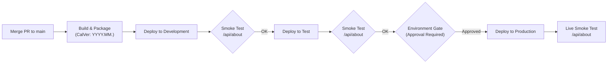

# Deployment Guide

This document is the authoritative guide for building, packaging, deploying, and verifying the **Estate Data Collection (EDC)** Azure Functions platform across all environments (**Development**, **Test**, and **Production**).

## Architectural Overview

The EDC platform operates on **Azure Functions (Isolated Worker Model)** targeting **.NET 10** hosted on **Azure Functions Flex Consumption (Linux)**.

```
┌────────────────────────────────────────────────────────────────────────┐
│ GitHub Actions / Azure CLI                                             │
│   │                                                                    │
│   ├──> dotnet publish -c Release -r linux-x64 --self-contained true     │
│   ├──> Exclude local.settings.json, *.http, *.pdb                      │
│   └──> Package into edc-functions-linux-x64.zip                        │
│                                                                        │
│ Azure Cloud (Flex Consumption / Linux)                                 │
│   │                                                                    │
│   ├──> Azure App Service Zip Deploy (az functionapp deployment source) │
│   ├──> Entra ID OIDC Authentication (No stored credentials)           │
│   └──> Managed Identity connecting to Azure Blob Storage & Key Vault   │
└────────────────────────────────────────────────────────────────────────┘
```

### Key Principles

- **Self-Contained Linux x64 Deployment ([ADR 0006](decisions/0006-flex-consumption-self-contained-deployment.md))**:
  Because Azure Functions Flex Consumption hosts run on Linux containers without guaranteed pre-installed .NET 10 runtimes, all deployment bundles are published with `-r linux-x64 --self-contained true`. The .NET runtime is bundled directly with the application, guaranteeing consistency across environments.
- **Build Once, Deploy Many ([ADR 0014](decisions/0014-segregated-multi-workflow-ci-cd-with-composite-actions.md))**:
  Binaries are compiled and tested once in CI, generating an immutable zip artifact that is promoted across Dev $\to$ Test $\to$ Prod.
- **Sanitised Packages**:
  Local dev settings (`local.settings.json`), REST client files (`*.http`), and symbol files (`*.pdb`) are strictly excluded from all deployable packages.

## Environment Topology

The platform is partitioned into three distinct Azure environments:

| Environment | Purpose | Azure Subscription / Resource Group | Function App Name | Deployment Gate |
| :--- | :--- | :--- | :--- | :--- |
| **Development** | Integration testing & active development | `rg-edc-dev-uksouth` | `func-edc-dev-uksouth` | Automated on merge to `main` |
| **Test** | QA, automated integration, stakeholder sign-off | `rg-edc-test-uksouth` | `func-edc-test-uksouth` | Automated promotion after Dev verification |
| **Production** | Live operational workload | `rg-edc-prod-uksouth` | `func-edc-prod-uksouth` | **Manual Review Required** (GitHub Environment Gate) |

---

## Deployment Options

### Option A: Automated Multi-Environment CI/CD (Recommended)

Continuous Delivery is driven by [`.github/workflows/cd-main.yml`](file:///.github/workflows/cd-main.yml).



1. **Trigger**: Automatically runs whenever a pull request is merged into the `main` branch.
2. **Process**:
   - Computes official CalVer version (`YYYY.MM.<run_number>`, e.g., `2026.10.42`).
   - Executes all unit tests and builds the self-contained Linux x64 release package.
   - Deploys to **Development** via OIDC and verifies health via `/api/about`.
   - Automatically promotes the identical artifact to **Test** and verifies health.
   - Pauses at the **Production** gate for required reviewer approval in GitHub before deploying to live.

### Option B: On-Demand / Historical SHA Deployment

For emergency hotfixes, rolling back, or testing specific Git revisions, use [`.github/workflows/deploy-by-sha.yml`](file:///.github/workflows/deploy-by-sha.yml).

1. Navigate to **GitHub** $\to$ **Actions** $\to$ **Deploy Commit to Environment**.
2. Click **Run workflow**.
3. Supply the inputs:
   - **Commit SHA**: Full 40-character SHA or short 7-character commit hash (e.g., `a1b2c3d`).
   - **Target Environment**: Select `development`, `test`, or `production`.
4. Click **Run workflow**. The workflow checks out the exact SHA, packages it, and pushes directly to the requested environment (respecting production approval gates if production is selected).

### Option C: Manual CLI Zip Deploy (`az CLI`)

To deploy directly from a developer workstation or build machine without triggering GitHub Actions:

#### 1. Prerequisites
- [.NET 10 SDK](https://dotnet.microsoft.com/)
- [Azure CLI](https://learn.microsoft.com/en-us/cli/azure/) (`az`)
- `zip` utility (standard on macOS and Linux)

#### 2. Build and Package Self-Contained Linux x64
```bash
# Navigate to the repository root
cd /path/to/estate-data-collection

# 1. Clean previous build artifacts
rm -rf ./publish-out ./edc-functions.zip

# 2. Publish self-contained for Linux x64 in Release mode
dotnet publish src/EstateDataCollection.AzureFunctions \
  -c Release \
  -r linux-x64 \
  --self-contained true \
  -o ./publish-out

# 3. Create deployment zip (excluding secrets and debug files)
cd ./publish-out
zip -r ../edc-functions.zip . -x "local.settings.json" "*.http" "*.pdb"
cd ..
```

#### 3. Log In to Azure and Deploy
```bash
# Log in to Azure (or use service principal / az login --identity)
az login

# Set the active subscription
az account set --subscription "<AZURE_SUBSCRIPTION_ID>"

# Deploy via Zip Deploy
az functionapp deployment source config-zip \
  --resource-group "<RESOURCE_GROUP_NAME>" \
  --name "<FUNCTION_APP_NAME>" \
  --src "./edc-functions.zip"

# Clean up local package
rm -rf ./publish-out ./edc-functions.zip
```

### Option D: Azure Functions Core Tools (`func`)

> [!CAUTION]
> Azure Functions Core Tools (`func azure functionapp publish`) compiles against the local host architecture by default. If publishing to Linux Flex Consumption from a macOS (ARM64) or Windows machine, prefer **Option A**, **B**, or **C** to prevent architecture mismatch errors.

For local sandbox or dev environments:
```bash
cd src/EstateDataCollection.AzureFunctions
az login
func azure functionapp publish <FUNCTION_APP_NAME>
```

## Zero-Trust Security & Authentication (Entra ID OIDC)

Deployments authenticate using **OpenID Connect (OIDC)** via GitHub Actions federated credentials. No long-lived passwords, client secrets, or publish profile XML files are stored in GitHub.

### OIDC Configuration in Entra ID

For each environment's Service Principal in Azure Entra ID:
1. Navigate to **Microsoft Entra ID** $\to$ **App Registrations** $\to$ Select the deployment app.
2. Go to **Certificates & secrets** $\to$ **Federated credentials** $\to$ **Add credential**.
3. Select **GitHub Actions deploying Azure resources**.
4. Configure the Subject Identifier format:

| Environment | Subject Identifier Format |
| :--- | :--- |
| **Development** | `repo:<org>/<repo>:environment:development` |
| **Test** | `repo:<org>/<repo>:environment:test` |
| **Production** | `repo:<org>/<repo>:environment:production` |

### Required GitHub Repository Configuration

Configure the following per environment under **GitHub Settings** $\to$ **Environments**:

| Type | Name | Example Value | Description |
| :--- | :--- | :--- | :--- |
| **Secret** | `AZURE_CLIENT_ID` | `00000000-0000-0000-0000-000000000000` | Entra ID App (Client) ID |
| **Secret** | `AZURE_TENANT_ID` | `00000000-0000-0000-0000-000000000000` | Entra ID Tenant ID |
| **Secret** | `AZURE_SUBSCRIPTION_ID` | `00000000-0000-0000-0000-000000000000` | Target Azure Subscription ID |
| **Variable** | `AZURE_RESOURCE_GROUP` | `rg-edc-prod-uksouth` | Azure Resource Group name |
| **Variable** | `AZURE_FUNCTION_APP_NAME` | `func-edc-prod-uksouth` | Target Azure Function App name |

---

## Required Environment Variables & Configuration

The following application settings must be configured in Azure Function App Configuration:

| Setting Name | Purpose | Example / Value |
| :--- | :--- | :--- |
| `FUNCTIONS_WORKER_RUNTIME` | Runtime worker type | `dotnet-isolated` |
| `BlobStorageOptions__ServiceUri` | Storage account URI using Managed Identity | `https://stedc<env>uksouth.blob.core.windows.net` |
| `BlobStorageOptions__ContainerName` | Default landing container | `edc-landing` |
| `APPLICATIONINSIGHTS_CONNECTION_STRING` | Azure Application Insights telemetry target | `InstrumentationKey=...` |
| `ASPNETCORE_ENVIRONMENT` | Active environment name | `Development` / `Test` / `Production` |

---

## Release Versioning & Observability (CalVer)

Deployments use **Calendar Versioning (CalVer)** ([ADR 0015](decisions/0015-calendar-versioning-calver-and-log-enrichment.md)) formatted as:

$$\text{YYYY.MM.<run\_number>} \quad \text{(e.g., } 2026.10.42\text{)}$$

### Where CalVer Appears:
1. **Assembly Metadata**: Injected at build time via `/p:InformationalVersion=...` into the compiled DLLs.
2. **About Endpoint**: Returned in HTTP responses at `GET /api/about`.
3. **OpenTelemetry Telemetry**: Stamped as `service.version` on every distributed trace and metric emitted to Application Insights.
4. **Structured Logs**: Added to the `ILogger` ambient scope for every incoming HTTP request by `VersionLoggingMiddleware`.

---

## Verification & Smoke Testing

Every deployment automatically performs a smoke test against the live function endpoint. You can run this test manually:

```bash
# Query the /api/about endpoint
curl -i https://<FUNCTION_APP_NAME>.azurewebsites.net/api/about
```

### Expected Response (`200 OK`)
```json
{
  "application": "EstateDataCollection",
  "version": "2026.10.42+a1b2c3d",
  "commitSha": "a1b2c3d4e5f6789012345678901234567890abcd",
  "environment": "Production",
  "timestampUtc": "2026-10-22T15:15:00.0000000Z"
}
```

If the endpoint returns anything other than HTTP `200 OK`, check the Function App logs or Application Insights Live Metrics.

---

## Rollback Strategy

If an incident or regression occurs in any environment:

### Method 1: Instant SHA Rollback via GitHub Actions (Recommended)
1. Go to **Actions** $\to$ **Deploy Commit to Environment** ([`.github/workflows/deploy-by-sha.yml`](file:///.github/workflows/deploy-by-sha.yml)).
2. Enter the **last known good Git commit SHA**.
3. Select the target environment (e.g., `production`).
4. Execute the workflow. GitHub will package that exact commit and deploy it, restoring known stable code.

### Method 2: Deployment Slot Swap (If Slots are Configured)
If staging deployment slots are enabled for the Function App:
```bash
az functionapp deployment slot swap \
  --resource-group "<RESOURCE_GROUP_NAME>" \
  --name "<FUNCTION_APP_NAME>" \
  --slot staging \
  --target-slot production
```

---

## Troubleshooting & Common Pitfalls

### 1. `System.IO.FileNotFoundException: Could not load file or assembly`
- **Cause**: The application was published framework-dependent without .NET 10 installed on the host container.
- **Fix**: Ensure `--self-contained true` and `-r linux-x64` are specified when running `dotnet publish` (per [ADR 0006](decisions/0006-flex-consumption-self-contained-deployment.md)).

### 2. `403 Forbidden` / `DefaultAzureCredential failed`
- **Cause**: Function App Managed Identity lacks the required RBAC role on the Azure Storage account.
- **Fix**: Assign the **Storage Blob Data Contributor** role to the Function App's System-Assigned Managed Identity on the target storage account.

### 3. `Blob storage container does not exist`
- **Cause**: Azure Storage account exists, but the landing container (`edc-landing`) has not been initialized.
- **Fix**: Deploy with self-healing container initialization enabled (per [ADR 0016](decisions/0016-self-healing-storage-container-initialisation.md)) or create the container manually:
  ```bash
  az storage container create --account-name "<STORAGE_ACCOUNT>" --name "edc-landing" --auth-mode login
  ```

### 4. GitHub Actions Deployment Error: `Federated token validation failed`
- **Cause**: The GitHub repository, branch, or environment name does not match the Subject Identifier configured in Entra ID.
- **Fix**: Verify that the federated credential subject matches `repo:<org>/<repo>:environment:<environment_name>`.

---

## Related Decisions & Documentation

- [ADR 0006: Flex Consumption Self-Contained Deployment](decisions/0006-flex-consumption-self-contained-deployment.md)
- [ADR 0010: Direct-to-Storage Landing Zone & SAS](decisions/0010-direct-to-storage-landing-zone-and-user-delegation-sas.md)
- [ADR 0014: Segregated Multi-Workflow CI/CD with Composite Actions](decisions/0014-segregated-multi-workflow-ci-cd-with-composite-actions.md)
- [ADR 0015: Calendar Versioning (CalVer) and Log Enrichment](decisions/0015-calendar-versioning-calver-and-log-enrichment.md)
- [ADR 0016: Self-Healing Storage Container Initialisation](decisions/0016-self-healing-storage-container-initialisation.md)
- [GitHub Actions Multi-Environment Guide](deployment/github-actions-multi-environment.md)
- [GitHub Deployments Dashboard Guide](deployment/github-deployments.md)
