```mermaid
flowchart TD
    subgraph PR_WORKFLOW["1. ci-pr.yml (Pull Request Quality Gate)"]
        PR["PR opened / updated"] --> PR_TEST["Restore & Run Tests (78 tests)"]
        PR_TEST --> PR_PKG["Package Linux x64 Self-Contained"]
        PR_PKG --> PR_COMMENT["Post/Update Sticky PR Comment with Test Metrics"]
    end

    subgraph CD_MAIN["2. cd-main.yml (Continuous Delivery on Main)"]
        MERGE["Merge into main"] --> BUILD["Build Release Artifact (CalVer: YYYY.MM.<run>)"]
        BUILD --> DEV["Deploy to 'development' Function App"]
        DEV --> SMOKE_DEV["Verify /api/about"]
        SMOKE_DEV --> TEST["Deploy to 'test' Function App"]
        TEST --> SMOKE_TEST["Verify /api/about"]
        SMOKE_TEST --> GATE{"GitHub Environment Gate\n(Required Reviewers / Approvals)"}
        GATE -- Approved --> PROD["Deploy to 'production' Function App"]
        PROD --> SMOKE_PROD["Live Verification"]
    end

    subgraph CD_SHA["3. deploy-by-sha.yml (Ad-Hoc / Rollback by Git SHA)"]
        DISPATCH["Manual workflow_dispatch\n(Input: SHA + Target Environment)"] --> BUILD_SHA["Checkout SHA & Package with CalVer"]
        BUILD_SHA --> DEPLOY_TARGET["Deploy Directly to Target (Dev / Test / Prod)"]
    end
```

# GitHub Actions Multi-Environment Deployment Guide

This document explains the CI/CD architecture for the **Estate Data Collection (EDC)** platform, deploying Azure Functions across three environments: **Development**, **Test**, and **Production**.

The solution uses a **segregated multi-workflow model** powered by reusable composite actions, automated CalVer versioning, and zero-trust Entra ID OIDC authentication.

---

## 1. Segregated Workflow Architecture

Instead of a single monolithic pipeline, the responsibilities are split into three dedicated workflows:

```
.github/
├── actions/
│   ├── setup-and-test/      # Reusable: SDK setup, 78 tests, TRX metrics, CalVer stamp, Linux x64 zip
│   └── deploy-function/     # Reusable: OIDC login, az config-zip, /api/about smoke test
└── workflows/
    ├── ci-pr.yml            # 1. CI Only: Triggered on Pull Requests to main
    ├── cd-main.yml          # 2. CD Release: Triggered on merge to main (Dev -> Test -> Prod Gate)
    └── deploy-by-sha.yml    # 3. On-Demand / Rollback: Triggered manually with any Git SHA & Target Environment
```



---

## 2. Key Architecture Principles

1. **Build Once, Deploy Many**:
   - The application is compiled, tested, and packaged into `edc-functions-linux-x64.zip` **only once** in the `build-release-artifact` job.
   - The identical binary package is promoted sequentially across Dev $\to$ Test $\to$ Prod.
2. **Deterministic CalVer Versioning**:
   - Versions follow `YYYY.0M.<run_number>` (e.g. `2026.10.42`), with full Git SHA metadata (`2026.10.42+a1b2c3d`).
   - Baked into assembly attributes (`InformationalVersion`) at build time via `/p:InformationalVersion=...`.
   - Exposed via `GET /api/about` and automatically stamped on all OpenTelemetry traces and `ILogger` execution scopes.
3. **Runtime Independence**:
   - Published with `--self-contained true` for `linux-x64` (per [ADR 0006](../decisions/0006-flex-consumption-self-contained-deployment.md)), ensuring .NET 10 runs deterministically on Azure Functions Flex Consumption without depending on host runtime installations.
4. **Artifact Sanitisation**:
   - Local secrets (`local.settings.json`), REST scripts (`*.http`), and bulky debug symbols (`*.pdb`) are explicitly excluded from the deployment zip.

---

## 3. Zero-Trust Authentication: Entra ID OIDC

The pipeline uses **OpenID Connect (OIDC)** federated credentials (`azure/login@v2`). No client secrets, passwords, or XML publish profiles are stored in GitHub.

### Setting up Federated Credentials in Azure Entra ID:
For each environment's App Registration / Service Principal in Azure:
1. Navigate to **Microsoft Entra ID** $\to$ **App Registrations** $\to$ Select your EDC deployment principal.
2. Go to **Certificates & secrets** $\to$ **Federated credentials** $\to$ **Add credential**.
3. Choose scenario: **GitHub Actions deploying Azure resources**.
4. Configure the entity based on GitHub environment:

| Azure Environment | GitHub Entity | Subject Identifier Format |
| :--- | :--- | :--- |
| **Development** | Environment | `repo:<org>/<repo>:environment:development` |
| **Test** | Environment | `repo:<org>/<repo>:environment:test` |
| **Production** | Environment | `repo:<org>/<repo>:environment:production` |

---

## 4. GitHub Environments Setup

In your GitHub repository, navigate to **Settings** $\to$ **Environments** and create three environments:

### Environment 1: `development`
- **Protection Rules**: None (deploys automatically on merge to `main`).
- **Variables**:
  - `AZURE_RESOURCE_GROUP`: `rg-edc-dev-uksouth`
  - `AZURE_FUNCTION_APP_NAME`: `func-edc-dev-uksouth`
- **Secrets**:
  - `AZURE_CLIENT_ID`: Entra ID Application (client) ID for Dev
  - `AZURE_TENANT_ID`: Azure Tenant ID
  - `AZURE_SUBSCRIPTION_ID`: Azure Subscription ID for Dev

### Environment 2: `test`
- **Protection Rules**: Optional wait timer or automated test gate.
- **Variables**:
  - `AZURE_RESOURCE_GROUP`: `rg-edc-test-uksouth`
  - `AZURE_FUNCTION_APP_NAME`: `func-edc-test-uksouth`
- **Secrets**:
  - `AZURE_CLIENT_ID`: Entra ID Application (client) ID for Test
  - `AZURE_TENANT_ID`: Azure Tenant ID
  - `AZURE_SUBSCRIPTION_ID`: Azure Subscription ID for Test

### Environment 3: `production`
- **Protection Rules**:
  - **Required Reviewers**: Add designated release engineers / tech leads who must approve before deployment begins.
  - **Deployment branches**: Restrict to `main`.
- **Variables**:
  - `AZURE_RESOURCE_GROUP`: `rg-edc-prod-uksouth`
  - `AZURE_FUNCTION_APP_NAME`: `func-edc-prod-uksouth`
- **Secrets**:
  - `AZURE_CLIENT_ID`: Entra ID Application (client) ID for Prod
  - `AZURE_TENANT_ID`: Azure Tenant ID
  - `AZURE_SUBSCRIPTION_ID`: Azure Subscription ID for Prod

---

## 5. Viewing Deployments (Octopus-Style Dashboard)

GitHub provides a built-in deployments dashboard at:
👉 **`https://github.com/<org>/<repo>/deployments`**
*(or via the **Environments** link on the repository homepage).*

This gives your team:
- Side-by-side status of what is currently live across **Development**, **Test**, and **Production**.
- Full release history and approval audit logs.
- Direct links to the live Function App endpoints.

For more details, see the [Deployments Dashboard Guide](github-deployments-dashboard.md).
