```mermaid
flowchart TD
    subgraph PR_WORKFLOW["1. ci-pr.yml (Pull Request Quality Gate)"]
        PR["PR opened / updated"] --> PR_TEST["Restore &amp; Run Tests (227 tests)"]
        PR_TEST --> PR_PKG["Package Public &amp; Admin Linux x64 Self-Contained"]
        PR_PKG --> PR_COMMENT["Post/Update Sticky PR Comment with Test Metrics"]
    end

    subgraph CD_MAIN["2. cd-main.yml (Continuous Delivery on Main)"]
        MERGE["Merge into main"] --> BUILD["Build Release Bundle (CalVer: YYYY.MM.&lt;run&gt;)"]
        BUILD --> DEV["Deploy Public &amp; Admin to 'Dev'"]
        DEV --> SMOKE_DEV["Verify /api/about &amp; /manage"]
        SMOKE_DEV --> TEST["Deploy Public &amp; Admin to 'Test'"]
        TEST --> SMOKE_TEST["Verify /api/about &amp; /manage"]
        SMOKE_TEST --> GATE{"GitHub Environment Gate\n(Required Reviewers / Approvals)"}
        GATE -- Approved --> PROD["Deploy Public &amp; Admin to 'Prod'"]
        PROD --> SMOKE_PROD["Live Verification"]
    end

    subgraph CD_SHA["3. deploy-by-sha.yml (Ad-Hoc / Rollback by Git SHA)"]
        DISPATCH["Manual workflow_dispatch\n(Input: SHA + Target Environment)"] --> BUILD_SHA["Checkout SHA &amp; Package with CalVer"]
        BUILD_SHA --> DEPLOY_TARGET["Deploy Public &amp; Admin to Target (Dev / Test / Prod)"]
    end
```

# GitHub Actions Multi-Environment Deployment Guide

This document explains the CI/CD architecture for the **Estate Data Collection (EDC)** platform, deploying Azure Functions across three environments: **Dev**, **Test**, and **Prod**.

The solution uses a **segregated multi-workflow model** powered by reusable composite actions, automated CalVer versioning, isolated Azurite testing, and zero-trust Entra ID OIDC authentication.

---

## 1. Segregated Workflow Architecture

Instead of a single monolithic pipeline, the responsibilities are split into three dedicated workflows:

```
.github/
├── actions/
│   ├── setup-and-test/      # Reusable: SDK setup, 227 tests + Azurite, CalVer stamp, Public & Admin Linux x64 zips
│   └── deploy-function/     # Reusable: OIDC login, az config-zip, smoke test
└── workflows/
    ├── ci-pr.yml            # 1. CI Only: Triggered on Pull Requests to main
    ├── cd-main.yml          # 2. CD Release: Triggered on merge to main (Dev -> Test -> Prod Gate)
    └── deploy-by-sha.yml    # 3. On-Demand / Rollback: Triggered manually with any Git SHA & Target Environment
```



---

## 2. Key Architecture Principles

1. **Build Once, Deploy Many**:
   - Both `edc-functions-public-linux-x64.zip` and `edc-functions-admin-linux-x64.zip` are compiled, tested, and packaged **only once** in the `build-release-artifact` job.
   - The identical binary bundle is promoted sequentially across Dev $\to$ Test $\to$ Prod.
2. **Deterministic CalVer Versioning**:
   - Versions follow `YYYY.MM.<run_number>` (e.g. `2026.11.42`), with full Git SHA metadata (`2026.11.42+a1b2c3d`).
   - Baked into assembly attributes (`InformationalVersion`) at build time via `/p:InformationalVersion=...`.
   - Exposed via `GET /api/about` and stamped onto OpenTelemetry traces, `ILogger` execution scopes, and `SchemaMetadata.LastTestRunAppVersion`.
3. **Runtime Independence**:
   - Published with `--self-contained true` for `linux-x64` (per [ADR 0006](../decisions/0006-flex-consumption-self-contained-deployment.md)), ensuring .NET 10 runs deterministically on Azure Functions Flex Consumption without depending on host runtime installations.
4. **Artifact Sanitisation**:
   - Local secrets (`local.settings.json`), REST scripts (`*.http`), and debug symbols (`*.pdb`) are explicitly excluded from deployment zips.

---

## 3. Zero-Trust Authentication: Entra ID OIDC

The pipeline uses **OpenID Connect (OIDC)** federated credentials (`azure/login@v2`). No client secrets, passwords, or XML publish profiles are stored in GitHub.

### Setting up Federated Credentials in Azure Entra ID:
For each environment's App Registration / Service Principal in Azure:
1. Navigate to **Microsoft Entra ID** $\to$ **App Registrations** $\to$ Select your EDC deployment principal.
2. Go to **Certificates & secrets** $\to$ **Federated credentials** $\to$ **Add credential**.
3. Choose scenario: **GitHub Actions deploying Azure resources**.
4. Configure the entity based on GitHub environment (note: organisations using immutable OIDC subjects include `@<owner_id>` and `@<repo_id>`):

| Azure Environment | GitHub Entity | Subject Identifier Format |
| :--- | :--- | :--- |
| **Dev** | Environment (`Dev`) | `repo:<org>/<repo>:environment:Dev` *(or immutable subject format)* |
| **Test** | Environment (`Test`) | `repo:<org>/<repo>:environment:Test` *(or immutable subject format)* |
| **Prod** | Environment (`Prod`) | `repo:<org>/<repo>:environment:Prod` *(or immutable subject format)* |

---

## 4. GitHub Environments Setup

In your GitHub repository, navigate to **Settings** $\to$ **Environments** and create three environments:

### Environment 1: `Dev`
These are example enviroment values
- **Protection Rules**: None (deploys automatically on merge to `main`).
- **Variables**:
  - `AZURE_RESOURCE_GROUP`: `rg-edc-dev`
  - `AZURE_PUBLIC_FUNCTION_APP_NAME`: `func-edc-public-dev`
  - `AZURE_ADMIN_FUNCTION_APP_NAME`: `func-edc-admin-dev`
- **Secrets**:
  - `AZURE_CLIENT_ID`: Entra ID Application (client) ID for Dev
  - `AZURE_TENANT_ID`: Azure Tenant ID
  - `AZURE_SUBSCRIPTION_ID`: Azure Subscription ID for Dev

### Environment 2: `Test`
- **Protection Rules**: Optional wait timer, automated test gate, or required reviewers until provisioned.
- **Variables**:
  - `AZURE_RESOURCE_GROUP`: `rg-edc-test`
  - `AZURE_PUBLIC_FUNCTION_APP_NAME`: `func-edc-public-test`
  - `AZURE_ADMIN_FUNCTION_APP_NAME`: `func-edc-admin-test`
- **Secrets**:
  - `AZURE_CLIENT_ID`: Entra ID Application (client) ID for Test
  - `AZURE_TENANT_ID`: Azure Tenant ID
  - `AZURE_SUBSCRIPTION_ID`: Azure Subscription ID for Test

### Environment 3: `Prod`
- **Protection Rules**:
  - **Required Reviewers**: Add designated release engineers / tech leads who must approve before deployment begins.
  - **Deployment branches**: Restrict to `main`.
- **Variables**:
  - `AZURE_RESOURCE_GROUP`: `rg-edc-prod-uksouth`
  - `AZURE_PUBLIC_FUNCTION_APP_NAME`: `func-edc-public-prod-uksouth`
  - `AZURE_ADMIN_FUNCTION_APP_NAME`: `func-edc-admin-prod-uksouth`
- **Secrets**:
  - `AZURE_CLIENT_ID`: Entra ID Application (client) ID for Prod
  - `AZURE_TENANT_ID`: Azure Tenant ID
  - `AZURE_SUBSCRIPTION_ID`: Azure Subscription ID for Prod

---

## 5. Viewing Deployments (Octopus-Style Dashboard)

GitHub provides a built-in deployments dashboard at:
👉 **`https://github.com/<org>/<repo>/deployments`**
*(or via the **Environments** link on the repository homepage).*

This gives your team:
- Side-by-side status of what is currently live across **Dev**, **Test**, and **Prod**.
- Full release history and approval audit logs.
- Direct links to the live Function App endpoints.

For more details, see the [Deployments Dashboard Guide](github-deployments.md).
