# Implementation Plan: Submission File Uploads, Microsoft Defender Malware Scanning & Per-File Manifests

- **Status:** Deferred / Separate Spike & Plan (Depends on Core Validation Workflow Engine)
- **Related Plans:**
  - [Validation Workflow Engine Plan](validation-workflow-engine-plan.md)
  - [ADR 0010 — Direct-to-Storage Landing Zone & User-Delegation SAS](../decisions/0010-direct-to-storage-landing-zone-and-user-delegation-sas.md)

---

## 1. Problem & Security Requirement

Rules such as `CCD-ELEM-V3-002` and `CCD-ELEM-V3-045` verify that `photoReference` (and future attachment identifiers) correspond to actual files uploaded alongside a submission. However, user-uploaded binary files cannot be indexed, trusted in validation, or promoted into the `processed` bundle folder until:

1. The upload is correlated with an active `submissionId` (and optionally `fileId` / metadata) **before** or **at** landing so scan results route back to the right submission.
2. **Microsoft Defender for Storage** scans the uploaded blob asynchronously and emits a scan verdict (`No threats found` vs `Malicious`).
3. The application **never consumes, trusts, or promotes** un-scanned or malicious files—and cleanly blocks/reports pending or failed scans when the submission runs validation or `/finalise`.

---

## 2. Proposed Architecture & Storage Flow

```mermaid
flowchart LR
    Client["Client App"] -->|"1. POST /submissions/{id}/files/init"| API["Public API (Generate Quarantine SAS + Init Pending Manifest)"]
    API -->|"Write status=PendingScan"| Manifest["quarantine / payloads: {submissionId}/files/{fileId}.manifest.json"]
    Client -->|"2. Direct PUT Binary via SAS\n(with blob index/metadata tags:\nsubmission_id, file_id)"| Quarantine["quarantine-files Container\n{submissionId}/files/{fileId}"]
    Quarantine -->|"3. BlobCreated"| Defender["Microsoft Defender for Storage\n(Malware Scanning)"]
    Defender -->|"4. Event Grid Verdict\nMicrosoft.Security.MalwareScanningResult"| ScanHandler["FileScanVerdictHandler\n[EventGridTrigger]"]
    ScanHandler -->|"Clean: Copy to verified store + Update Manifest (Clean)"| Verified["payloads/{submissionId}/files/{fileId}\n+ {fileId}.manifest.json"]
    ScanHandler -->|"Malicious: Quarantine / Delete + Update Manifest (Infected)"| Blocked["Record Security Incident & Mark Infected"]
    Verified -->|"5. On Validate / Finalise"| WorkflowStep["file-manifest-enrichment\nIWorkflowStep"]
    Verified -->|"6. On Finalise Promotion"| Processed["processed/.../{submissionId}/files/"]
```

---

## 3. Key Design Areas to Finalise

### 3.1 Pre-Scan Association (`submissionId` + `fileId`)
- **Two-step SAS upload & manifest registration (`POST /api/submissions/{submissionId}/files`):**
  1. Validates the `SubmissionSession` exists and is still in `Draft` (not `Finalised`).
  2. Allocates a `fileId` (or validates caller-supplied `fileId`), enforces allowed MIME types and max file size in metadata/SAS policy, and creates `{submissionId}/files/{fileId}.manifest.json` with `scanStatus = "Pending"`.
  3. Returns a scoped, short-lived **write-only SAS URL** targeting a dedicated **untrusted landing container** (`quarantine-files/{submissionId}/files/{fileId}`), attaching immutable blob metadata / blob index tags:
     - `submission_id = {submissionId}`
     - `file_id = {fileId}`
     - `original_file_name = ...`
- Why a separate `quarantine-files` landing container? Isolates unverified bytes away from `payloads/` and `processed/`, allows lifecycle auto-expiry on abandoned/unscanned uploads, and matches Microsoft Defender for Storage "On-upload malware scanning" best practices.

### 3.2 Defender Scan Verdict Event Grid Integration
- Subscribe an Event Grid trigger (`HandleFileMalwareScanResult`) to `Microsoft.Security.MalwareScanningResult` (plus a fallback blob-tag reader if Defender updates `Malware Scanning scan result` tags).
- Resolve `submissionId` and `fileId` deterministically from the scanned blob path (`{submissionId}/files/{fileId}`) and verify against blob metadata (`submission_id`, `file_id`).
- Handle outcomes idempotently:
  - **`No threats found` (`Clean`):**
    - Move/copy verified blob into `payloads/{submissionId}/files/{fileId}` (or promote to `clean-files` bucket) and delete from `quarantine-files`.
    - Update `{submissionId}/files/{fileId}.manifest.json`:
      `scanStatus = "Clean"`, `scannedAtUtc`, `sha256`, `contentType`, `sizeBytes`, `defenderScanId`.
  - **`Malicious` (`Infected`):**
    - Delete or retain in locked quarantine container per DfE security policy (never copy to `payloads` or `processed`).
    - Update manifest `scanStatus = "Malicious"` with verdict details and append a high-severity submission audit entry.
  - **`Scan failed` / `Error`:**
    - Mark manifest `scanStatus = "ScanFailed"` so the user knows to re-upload.

### 3.3 `file-manifest-enrichment` Workflow Step
- Plugs cleanly into [`IValidationWorkflowRunner`](validation-workflow-engine-plan.md#L118-L120) as a registered `IWorkflowStep` (`StepId = "file-manifest-enrichment"`) right after `identifier-extraction`:
  - Reads **only** `{submissionId}/files/*.manifest.json` (never reads unverified binary blobs).
  - Populates `ambient.files`:
    - `clean_file_ids`: `fileId`s where `scanStatus == "Clean"` (used by rules like `photoReference in ambient.files.clean_file_ids`).
    - `pending_file_ids`: files still awaiting Defender scan.
    - `rejected_file_ids`: files flagged `Malicious` or `ScanFailed`.
  - **Finalise Gate Behaviour:**
    - Configurable per `SchemaValidationPolicy`:
      - If any file is `Malicious`: emit a **`Critical`** / **`Error`** issue and reject finalisation.
      - If any referenced file is still `Pending`: return `409 Conflict` / validation issue (`ScanPending`) asking client to retry once Defender completes (typically seconds).

### 3.4 Processed Bundle Archival
- Once all required files are `Clean`, `BlobSubmissionInfrastructure.PromoteToProcessedAsync` copies `{submissionId}/files/*` (both verified binaries and `.manifest.json` files) into:
  `processed/{identifierType}={establishmentIdentifier}/schema={schemaName}/v={schemaVersion}/{submissionId}/files/`

---

## 4. Open Investigation Items Before Implementation

1. Confirm Azure subscription provisioning of **Microsoft Defender for Storage (Malware Scanning plan)** and whether scan results are delivered via **Event Grid (`Microsoft.Security.MalwareScanningResult`)** or **Storage Blob Index Tags** in DfE environments.
2. Confirm quarantine retention vs automatic delete policy for `Malicious` blobs and security team alerting hooks.
3. Confirm Azurite / local-dev simulation strategy (e.g., a local `POST /dev/files/{submissionId}/{fileId}/simulate-scan` or Admin/Dev endpoint to mimic Defender Event Grid events in integration tests and local Postman).
