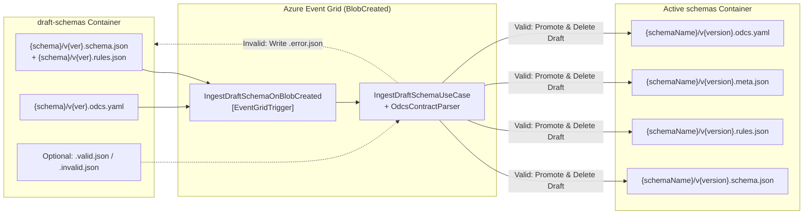

# Implementation Plan: ODCS v3.2.0 Contracts, Multi-Engine Quality Validation (`JsonLogic` & `CEL`), and Dual-Route Event-Driven Schema Ingestion

## 1. Worktree & Downloaded Contracts

A dedicated git worktree branched off `main` (`250878e`) has been created at:
- **Worktree Directory:** [`.worktrees/latest-odcs-schemas`](file:///Users/chriskelly/Downloads/edc-mvp/src-dotnet-corrolation/estate-data-collection/.worktrees/latest-odcs-schemas)
- **Branch:** `feature/latest-odcs-schemas`

All contracts, generated schemas, and the CI workflow from `DFE-Digital/cde-data-contracts` have been pulled into [`.worktrees/latest-odcs-schemas/cde-data-contracts/`](file:///Users/chriskelly/Downloads/edc-mvp/src-dotnet-corrolation/estate-data-collection/.worktrees/latest-odcs-schemas/cde-data-contracts):

| ODCS v3.2.0 Contract | Generated JSON Schema | Companion Rules File | Contract ID | Quality Rules Present |
| :--- | :--- | :--- | :--- | :--- |
| [`edc-school-site-jsonlogic.odcs.yaml`](file:///Users/chriskelly/Downloads/edc-mvp/src-dotnet-corrolation/estate-data-collection/.worktrees/latest-odcs-schemas/cde-data-contracts/contracts/edc-school-site-jsonlogic.odcs.yaml) | [`edc-school-site.schema.json`](file:///Users/chriskelly/Downloads/edc-mvp/src-dotnet-corrolation/estate-data-collection/.worktrees/latest-odcs-schemas/cde-data-contracts/schemas/edc-school-site.schema.json) | `edc-school-site.rules.json` | `edc-survey-sites` | `CDC-DQ1-JSONLogic` (`engine: jsonlogic` on `survey`) |
| [`edc-survey-elements.odcs.yaml`](file:///Users/chriskelly/Downloads/edc-mvp/src-dotnet-corrolation/estate-data-collection/.worktrees/latest-odcs-schemas/cde-data-contracts/contracts/edc-survey-elements.odcs.yaml) | [`edc-survey-elements.schema.json`](file:///Users/chriskelly/Downloads/edc-mvp/src-dotnet-corrolation/estate-data-collection/.worktrees/latest-odcs-schemas/cde-data-contracts/schemas/edc-survey-elements.schema.json) | `edc-survey-elements.rules.json` | `edc-survey-elements` | `CDC-DQ1-JSONLogic` (`engine: jsonlogic` on `survey`) |
| [`edc-survey-evidenceandanswers.odcs.yaml`](file:///Users/chriskelly/Downloads/edc-mvp/src-dotnet-corrolation/estate-data-collection/.worktrees/latest-odcs-schemas/cde-data-contracts/contracts/edc-survey-evidenceandanswers.odcs.yaml) | [`edc-survey-evidenceandanswers.schema.json`](file:///Users/chriskelly/Downloads/edc-mvp/src-dotnet-corrolation/estate-data-collection/.worktrees/latest-odcs-schemas/cde-data-contracts/schemas/edc-survey-evidenceandanswers.schema.json) | `edc-survey-evidenceandanswers.rules.json` | `edc-survey-answers-evidence` | `CDC-DQ1-JSONLogic` (`engine: jsonlogic` on `survey`) |

## 2. Dual-Route Contract Ingestion & Draft Container Event Grid Pipeline

Because `datacontract-cli` strips `quality` blocks when exporting `.schema.json`, EDC supports **two ingestion routes** (automatically routed by file type / content format) across both **HTTP endpoints** and **Azure Event Grid (`Microsoft.Storage.BlobCreated`) on the `draft-schemas` container**:

### Route A (Option 2): Paired `{schema}.schema.json` + `{schema}.rules.json`
- **Blob Storage Layout (`BlobSchemaRegistryOptions`):**
  - `ContainerName`: `"schemas"`
  - `DraftContainerName`: `"draft-schemas"`
  - `DraftErrorBlobSuffix`: `".error.json"`
  - `SchemaBlobDirectory`: `"{schemaName}/v{version}.schema.json"`
  - `RulesBlobDirectory`: `"{schemaName}/v{version}.rules.json"`
  - `MetaBlobDirectory`: `"{schemaName}/v{version}.meta.json"`
- **Event Grid & HTTP Support (`IngestDraftSchemaOnBlobCreated`, `VerifySchema` & `SubmitSchema`):**
  - Accepts `schemaJson` (`{schema}.schema.json`) and optional `rulesJson` (`{schema}.rules.json`), plus optional `.valid.json` / `.invalid.json` companion fixtures.

### Route B (Option 3): Direct `.odcs.yaml` Injection (Detected by File Type / Format)
- **`OdcsContractParser` (`YamlDotNet`):**
  - Parses `.odcs.yaml` contracts directly into a Draft-07 JSON Schema (`{schema}.schema.json`) and extracts all nested `quality` rules into `BusinessRule` items (`{schema}.rules.json`) with their computed `path` (e.g. `survey`, `elements[].occurrences[]`).
- **SchemaName & Version Resolution in `draft-schemas`:**
  - Resolves `{schemaName}/v{version}.{ext}` from the blob path convention first, falling back automatically to metadata inside the file (`id` / `version` in ODCS YAML or `$id` / `title` / `version` in JSON Schema).
- **Promotion & Error Reporting:**
  - Valid contracts are promoted to the `schemas` container and deleted from `draft-schemas`.
  - Invalid contracts remain in `draft-schemas` with a companion `{blobPath}.error.json` diagnostic report.

## 3. High-Performance Multi-Engine Quality Validation (`FrozenDictionary` + Path Grouping)

### 1. Unified `BusinessRule` Model
Unifies ODCS v3.2.0 `quality` definitions and standalone `.rules.json` definitions:
- `Id` (`string`)
- `Type` (`string`, defaults to `"custom"`)
- `Engine` (`string?`, e.g. `"jsonlogic"`, `"cel"` — falls back to `ValidationOptions.DefaultEngine`)
- `Description` (`string`)
- `Message` (`string?` — falls back to `Description` when omitted)
- `Severity` (`string`, defaults to `"ERROR"`)
- `Path` (`string`, e.g. `"survey"`, `"elements[].occurrences[]"`)
- `Implementation` (`JsonNode?`, with `"assert"` supported as a backward-compatible alias)

### 2. `JsonLogicValidator` with `FrozenDictionary<string, IQualityRuleEngine>` & Path Grouping
- **Engine Lookup:**
  - Injects `IEnumerable<IQualityRuleEngine>` (auto-registered via Scrutor) and builds a `FrozenDictionary<string, IQualityRuleEngine>(StringComparer.OrdinalIgnoreCase)` once in the constructor for zero-allocation $O(1)$ lookup.
  - Validates against `ValidationOptions.EnabledEngines` (`FrozenSet<string>`).
  - If an unknown or disabled engine is encountered, fails verification and validation immediately when `ValidationOptions.UnknownEngineBehavior == UnknownEngineBehavior.Fail` (the default).
- **Path-Grouped Evaluation:**
  - Groups active rules by `rule.Path` so each target path in the JSON payload is traversed and enriched **only once**, even when multiple `jsonlogic` and `cel` rules target the same path.

### 3. Out-of-the-Box Engines
1. **`JsonLogicQualityEngine` (`engine: "jsonlogic"`)**:
   - Uses `JsonLogic` (`Json.Logic` v5.3.0) with compiled rule caching.
   - Supports ISO-8601 `DateTimeOffset` and string comparisons on `>=`, `>`, `<=`, `<`, `==`, `!=` (solving `survey.updated_at >= survey.created_at` on ISO-8601 timestamp strings) as well as `!in` and `.length` on arrays.
2. **`CelQualityEngine` (`engine: "cel"`)**:
   - Compiles and evaluates Common Expression Language (CEL) string expressions with AST caching (`Celly`).
   - Supports logical/comparison operators (`&&`, `||`, `!`, `==`, `!=`, `<`, `<=`, `>`, `>=`, `? :`), `timestamp()`, `int()`, `double()`, `string()`, `size()`, `has()`, `in`, and string functions.

## 4. Configuration (`ValidationOptions`) & Schema/URN Tweaks

### `ValidationOptions` (`"Validation"` configuration section)
- `EnabledEngines`: `["jsonlogic", "cel"]`
- `DefaultEngine`: `"jsonlogic"`
- `UnknownEngineBehavior`: `UnknownEngineBehavior.Fail` (`Fail` | `Skip`)
- `RunQualityRulesOnDraftUpdate`: `true`
- `TreatWarningsAsErrors`: `false`
- `RequireFormatValidation`: `true`
- `AllowedMetaSchemas`: `["https://json-schema.org/draft/2020-12/schema", "http://json-schema.org/draft-07/schema#", "https://json-schema.org/draft-07/schema#"]`
- `RequireUrnOnFinalise`: `true`
- `UrnJsonPaths`: `["school.urn", "urn"]`
