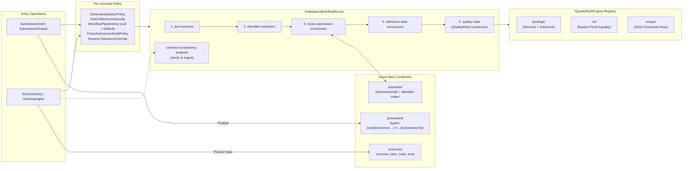
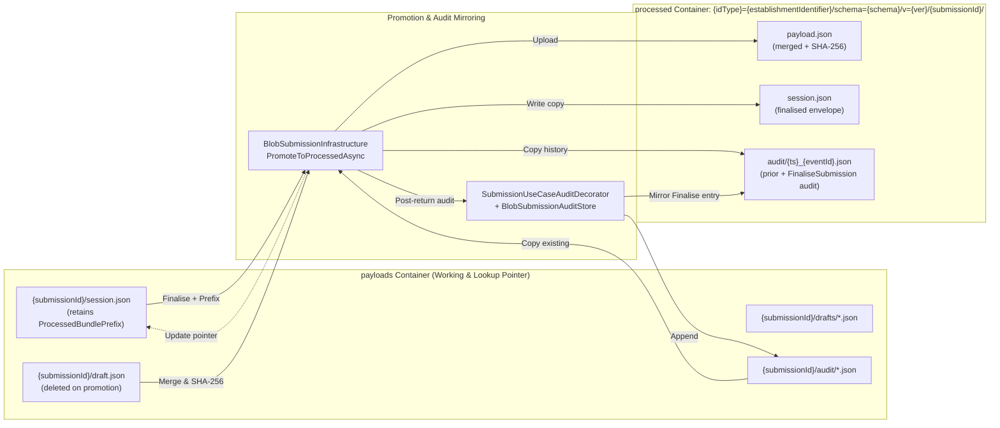
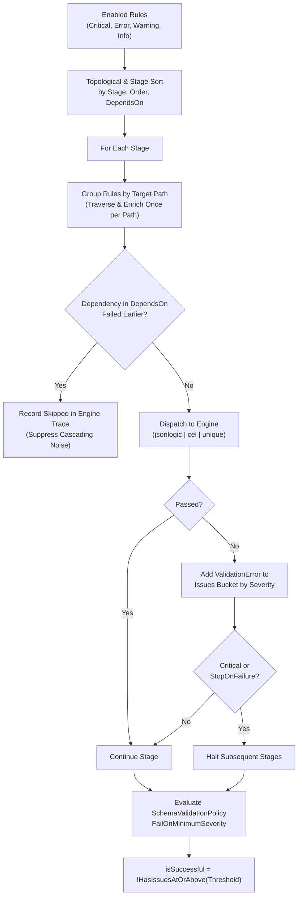
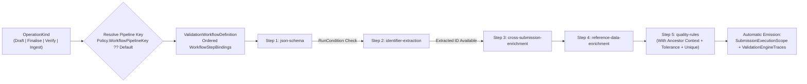
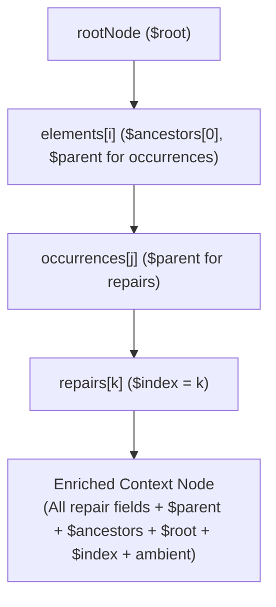
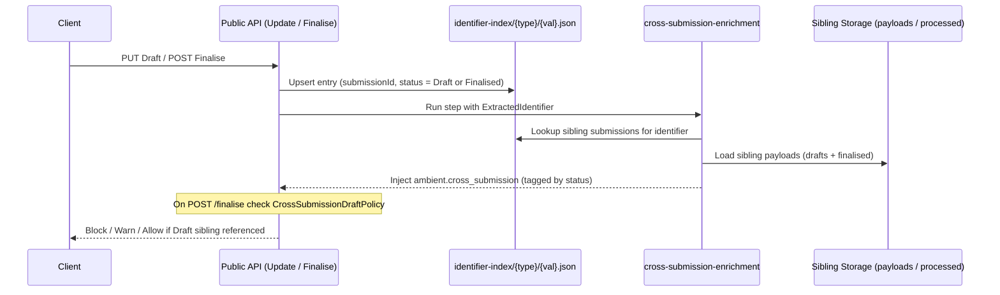
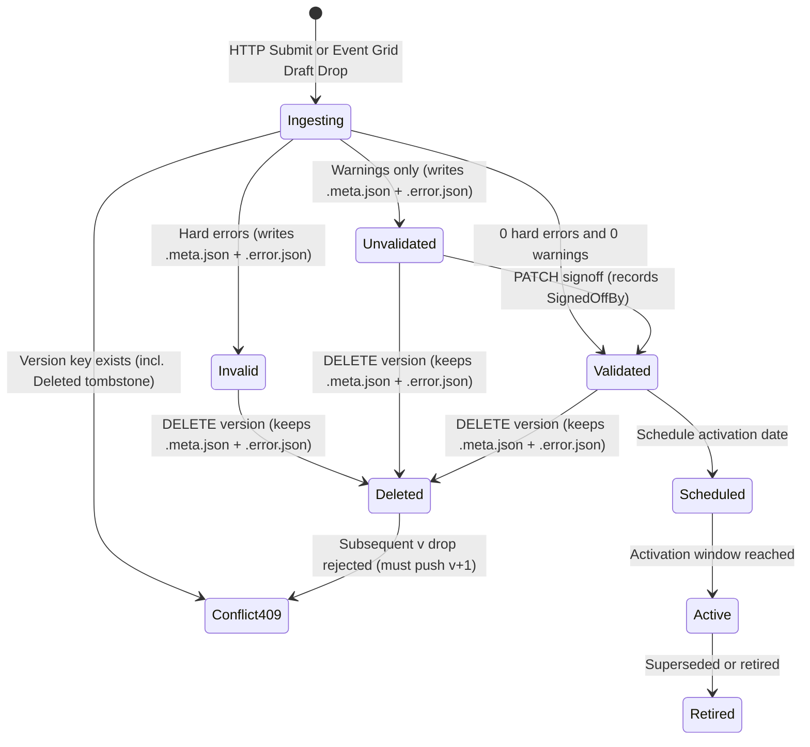

# Implementation Plan: Pluggable Validation Workflow Engine, Severity Pipeline, Generic Establishment Identifiers & Schema Lifecycle

- **Worktree:** `.worktrees/validation-workflow-engine`
- **Branch:** `feature/validation-workflow-engine` (branched from `main` at `7379317`)
- **Status:** Proposed Plan (Ready for Review)

## Goals & Architectural Principles

1. **Make all code-level identifier concepts agnostic** (`identifierType` + `identifierValue` / `establishmentIdentifier`, generic option/property names, uniform scalar validation, generic UI labels) while **preserving `URN` as the configuration default** (`ValidationOptions`, `BlobSubmissionRepositoryOptions`, `local.settings*.json`) so existing deployments continue working seamlessly.
2. **Promote each finalised submission as a self-contained `processed` bundle folder** (`urn={establishmentIdentifier}/schema={schemaName}/v={schemaVersion}/{submissionId}/`) containing `payload.json`, `session.json` (session envelope), and `audit/*.json`.
3. **Introduce a composable, data-driven Validation Workflow Pipeline** where every capability (schema validation, identifier extraction, cross-submission enrichment, reference-data enrichment, quality rules across JSON Logic / CEL / `unique`, contract consistency analysis) is an independent, injectable step/engine with its own `ValidationEngineDescriptor` and trace.
4. **Support 4-tier `RuleSeverity` (`Critical`, `Error`, `Warning`, `Info`)** across all quality rule engines, runbook/stage ordering (`Stage`, `Order`, `DependsOn`, `StopOnFailure`), an `issues` dictionary grouped by severity, and a **per-schema `SchemaValidationPolicy`** controlling what severity determines `isSuccessful` (plus optional nullable `WorkflowPipelineKey` override).
5. **Keep ODCS rule authoring clean for automated generation (Databricks / Open Metadata)** by handling numeric floating-point tolerance automatically in both JSON Logic and CEL engines, injecting `$parent` / `$ancestors` / `$root` / `$index` context in `RuleTargetResolver`, and providing a built-in $O(N)$ `unique` composite-key rule type.
6. **Support cross-submission lookups (draft + finalised)** governed by per-schema draft policy.
7. **Turn `POST /schemas/verify` into a non-failing diagnostic report** and expand `SchemaLifecycleState` with **`Invalid`**, **`Unvalidated`** (warning-level sign-off), and **`Deleted`** (tombstone preserving `.meta.json` + `.error.json` so consumed version keys cannot be overwritten and fixes must advance to `version + 1`).

### Architecture Overview



## Deferred / Separate Plans

The following capabilities depend on additional discovery/infrastructure and are tracked in their own dedicated plans under `docs/plans/`:
- **Submission File Uploads, Defender Malware Scanning & Per-File Manifests:** See [File Upload, Defender Scan & Per-File Manifest Plan](file-upload-defender-manifest-plan.md).
- **SQL Quality Validation Engine (`type: sql` / `engine: sql`):** See [SQL Quality Validation Engine Plan](sql-quality-engine-plan.md).

## Phase 0 — Identifier-Agnostic Codebase (Keeping `URN` in Configuration Defaults) & Processed Submission Bundle Folder

Building on [ADR 0019](../decisions/0019-configurable-schema-verified-identifier-partitioning.md), decouple all code symbols, domain validation, error codes, and UI copy from `URN`, keep `URN` values in configuration defaults (`ValidationOptions`, `BlobSubmissionRepositoryOptions`, `local.settings*.json`), and upgrade the `processed` container output from a single JSON blob to a self-contained `{submissionId}/` bundle folder.

### 0.1 Identifier-Agnostic Code Symbols & Config Defaults
- **Domain (`src/EstateDataCollection.Domain`):**
  - [`SchemaIdentifierConfig.cs`](../../src/EstateDataCollection.Domain/Schema/SchemaIdentifierConfig.cs):
    - Rename `DefaultUrnType` → `DefaultIdentifierType` (retaining `"URN"` as the default configured fallback or accepting `ValidationOptions.DefaultIdentifierType`).
    - Update XML docs and validation messages to be identifier-agnostic.
  - [`SubmissionIdentifier.cs`](../../src/EstateDataCollection.Domain/Submission/SubmissionIdentifier.cs):
    - Remove the `URN`-only positive-integer special-casing in `Create` and `InspectPayload` (lines 54–61 and 113–128) so all identifier types follow uniform scalar (`string` / `number`) + storage-path safety validation (format constraints like `^[0-9]{6}$` belong in JSON Schema, not hardcoded by type label).
    - Inject default fallback paths from `ValidationOptions` rather than hardcoding `DefaultIdentifierPaths` in domain code (retaining `["school.urn", "urn"]` as the config default).
- **Common (`src/EstateDataCollection.Common`):**
  - [`ErrorCodes.cs`](../../src/EstateDataCollection.Common/Results/ErrorCodes.cs): Replace `PayloadInvalidUrn` with `PayloadInvalidIdentifier` (no `URN`-specific error code branch).
- **Application (`src/EstateDataCollection.Application`):**
  - [`ValidationOptions.cs`](../../src/EstateDataCollection.Application/Models/Options/ValidationOptions.cs):
    - Rename `RequireUrnOnFinalise` → `RequireIdentifierOnFinalise` (default `true`).
    - Rename `UrnJsonPaths` → `DefaultIdentifierJsonPaths` (default `["school.urn", "urn"]`).
    - Add `DefaultIdentifierType` (default `"URN"`).
    - Add `DefaultIdentifierPointerFallback` (derived from `DefaultIdentifierJsonPaths[0]`, defaulting to `"/urn"`).
  - [`PayloadIdentifierExtractor.cs`](../../src/EstateDataCollection.Application/Validators/PayloadIdentifierExtractor.cs), [`IdentifierSchemaValidator.cs`](../../src/EstateDataCollection.Application/Validators/IdentifierSchemaValidator.cs), [`SchemaVerificationService.cs`](../../src/EstateDataCollection.Application/Validators/SchemaVerificationService.cs), [`ScheduleSchemaUseCase.cs`](../../src/EstateDataCollection.Application/UseCases/Schema/ScheduleSchema/ScheduleSchemaUseCase.cs):
    - Update code references to use the generic option properties and `PayloadInvalidIdentifier`.
- **Admin UI, Docs & Tests:**
  - Update UI labels in `SubmissionsPage.razor`, `SubmissionDetailPage.razor`, `ScheduleSchemaPage.razor` (`Identifier` / `Establishment Identifier` instead of `Identifier / URN`).
  - Update unit/integration tests for the renamed generic symbols (`RequireIdentifierOnFinalise`, `DefaultIdentifierJsonPaths`, `PayloadInvalidIdentifier`) while preserving config-default tests.

### 0.2 Processed Submission Bundle Folder (`{submissionId}/`)



- **Configuration Defaults (`BlobSubmissionRepositoryOptions.cs` & `local.settings*.json`):**
  - Update `ProcessedBlobNameFormat` default in [`BlobSubmissionRepositoryOptions.cs`](../../src/EstateDataCollection.Infrastructure/Persistence/BlobSubmissionRepositoryOptions.cs) and `src/EstateDataCollection.AzureFunctions.*/local.settings.example.json` to:
    `"urn={establishmentIdentifier}/schema={schemaName}/v={schemaVersion}/{submissionId}/payload.json"`
- **Path Resolution ([`SubmissionBlobPathResolver.cs`](../../src/EstateDataCollection.Infrastructure/Persistence/SubmissionBlobPathResolver.cs)):**
  - Replace hardcoded `urn={urn}` replacement logic with generic identifier-agnostic resolution supporting `{establishmentIdentifier}`, `{identifierValue}`, `{identifierType}`, and legacy `{urn}` placeholders:
    - If `identifierType` differs from `"urn"` (or when `{identifierType}` is explicit), format as `{safeType}={safeValue}/...`; when no identifier is present, strip the identifier segment cleanly (or use `unidentified/`).
  - Add `ResolveProcessedBundlePrefix(...)` (the `{submissionId}/` parent prefix derived from `ProcessedBlobNameFormat`), plus helpers for bundle members:
    - `{bundlePrefix}payload.json`
    - `{bundlePrefix}session.json`
    - `{bundlePrefix}audit/{timestamp}_{eventId}.json`
- **Session Envelope, Promotion & Audit Mirroring:**
  - [`SubmissionSession.cs`](../../src/EstateDataCollection.Domain/Submission/SubmissionSession.cs): Add `[JsonInclude] public string? ProcessedBundlePrefix { get; private set; }` (recorded on `Finalise(string? processedBundlePrefix)`).
  - [`BlobSubmissionInfrastructure.PromoteToProcessedAsync`](../../src/EstateDataCollection.Infrastructure/Persistence/BlobSubmissionInfrastructure.cs):
    1. Resolves target `payload.json` path and `bundlePrefix`.
    2. Uploads `{bundlePrefix}payload.json` with SHA-256 & submission metadata.
    3. Copies all existing audit entries from `payloads/{submissionId}/audit/` into `processed/{bundlePrefix}audit/`.
    4. Calls `session.Finalise(bundlePrefix)` (plus `AssignIdentifier`), writes the updated session envelope to **both** `processed/{bundlePrefix}session.json` and `payloads/{submissionId}/session.json` (so $O(1)$ `GET /submissions/{submissionId}` lookups still resolve without scanning `processed`).
    5. Deletes working `payloads/{submissionId}/draft.json` (retaining `session.json` as lookup pointer + `drafts/`/`audit/` in `payloads`), and tracks all uploaded `processed/{bundlePrefix}*` blob names for transactional rollback on failure.
  - [`FinaliseSubmissionUseCase.cs`](../../src/EstateDataCollection.Application/UseCases/Submissions/FinaliseSubmission/FinaliseSubmissionUseCase.cs), [`SubmissionExecutionScope.cs`](../../src/EstateDataCollection.Application/UseCases/Submissions/Audit/SubmissionExecutionScope.cs) & [`BlobSubmissionAuditStore.cs`](../../src/EstateDataCollection.Infrastructure/Persistence/BlobSubmissionAuditStore.cs):
    - Because `SubmissionUseCaseAuditDecorator` writes the `"FinaliseSubmission"` `"Succeeded"` audit entry *after* `FinaliseSubmissionUseCase` returns, `PromoteToProcessedAsync` surfaces the resolved `ProcessedBundlePrefix` (via scope/session context), and `BlobSubmissionAuditStore.AppendAsync` mirrors any audit entry written after promotion into `processed/{ProcessedBundlePrefix}audit/{ts}_{eventId}.json` as well as `payloads/{submissionId}/audit/{ts}_{eventId}.json`.
  - [`BlobSubmissionQueryRepository.GetProcessedArtefactAsync`](../../src/EstateDataCollection.Infrastructure/Persistence/BlobSubmissionQueryRepository.cs):
    - Resolves `session.ProcessedBundlePrefix + "payload.json"` (or `ProcessedBlobNameFormat`), with fallback matching both `/{submissionId}/payload.json` and legacy `/{submissionId}.json` blobs so historical records stay readable.

## Phase 1 — `RuleSeverity` Enum, `Issues` Dictionary, Runbook Ordering & Per-Schema Policy

### 1.1 `RuleSeverity` & `ValidationIssue`
- Add `RuleSeverity` enum in `EstateDataCollection.Common.Results`:
  ```csharp
  public enum RuleSeverity
  {
      Critical = 0,
      Error = 1,
      Warning = 2,
      Info = 3
  }
  ```
- Extend [`ValidationError`](../../src/EstateDataCollection.Common/Results/ValidationError.cs) (preserving backwards-compatible defaults):
  - `RuleSeverity Severity = RuleSeverity.Error`
  - `string? Action = null` (e.g., `reject_submission`, `highlight_issue`, `allow_submission`)
  - `string? EngineId = null`
- Update [`BusinessRule`](../../src/EstateDataCollection.Application/Validators/Logic/BusinessRule.cs):
  - `Severity` typed as `RuleSeverity` (with a case-insensitive JSON converter supporting `"CRITICAL"`, `"ERROR"`, `"WARNING"`, `"INFO"`, `"warn"`, etc.).
  - Add runbook/ordering fields:
    - `int Stage { get; init; } = 100;`
    - `int Order { get; init; } = 0;`
    - `IReadOnlyList<string>? DependsOn { get; init; }`
    - `bool StopOnFailure { get; init; }` (defaults to `true` when `Severity == RuleSeverity.Critical`)
  - Allow `Implementation` / `Assert` to be optional when `Severity == RuleSeverity.Info` (pure advisory notice emitted at target path, e.g. `CCD-ELEM-V3-038`).

### 1.2 `Issues` Dictionary & `SchemaValidationPolicy`
- Add `SchemaValidationPolicy` on [`SchemaMetadata`](../../src/EstateDataCollection.Domain/Schema/SchemaMetadata.cs) (configurable via ODCS `customProperties`, schema submission, or schedule/config endpoint):
  - `RuleSeverity FailOnMinimumSeverity { get; init; } = RuleSeverity.Error;` (`Error` means `Critical` + `Error` fail `isSuccessful`; setting `Warning` escalates `Warning`s to fail `isSuccessful`)
  - `string? WorkflowPipelineKey { get; init; } = null;` (`null` resolves the global `"Default"` pipeline; setting a non-null key overrides the pipeline for that specific schema)
  - `CrossSubmissionDraftPolicy CrossSubmissionDraftPolicy { get; init; } = CrossSubmissionDraftPolicy.WarnOnDraftReferences;`
  - `decimal? NumericToleranceOverride { get; init; }`
- Update `PayloadValidationReport`, `UpdateSubmissionResult`, `GetSubmissionStatusResult`, `FinaliseSubmissionResult` to return:
  - `Issues`: `IReadOnlyDictionary<RuleSeverity, IReadOnlyList<ValidationError>>` (serialized with lowercase keys `critical`, `error`, `warning`, `info`)
  - `IsSuccessful` / `IsReadyToFinalise`: evaluated dynamically against `SchemaValidationPolicy.FailOnMinimumSeverity` (`!HasIssuesAtOrAbove(policy.FailOnMinimumSeverity)`).
  - *(Transition compatibility)*: `PendingErrors` projects blocking issues (`<= FailOnMinimumSeverity`) during transition and can be deprecated cleanly once Admin UI & Postman migrate to `issues`.

### 1.3 Runbook / Stage Execution Across All Quality Rule Engines (`IBusinessLogicValidator`)
> **Note:** [`JsonLogicValidator`](../../src/EstateDataCollection.Infrastructure/Validation/JsonLogicValidator.cs) implements `IBusinessLogicValidator` and is actually the central quality-rule coordinator that dispatches to **all** registered `IQualityRuleEngine` implementations (`JsonLogicQualityEngine` for `jsonlogic`, `CelQualityEngine` for `cel`, and in Phase 2 `UniqueCombinationQualityEngine` for `unique`). As part of this phase, rename/alias it to `QualityRuleCoordinator` (keeping backwards-compatible registration if needed) so the architecture accurately reflects that severity, ordering, and target enrichment govern **every** quality engine equally—not just JSON Logic.



- Update the coordinator (`JsonLogicValidator` / `QualityRuleCoordinator`) so it **evaluates all enabled severities** (`Critical`, `Error`, `Warning`, `Info`) across `jsonlogic`, `cel`, and `unique` instead of skipping `WARNING`.
- Execution order:
  1. Topological/stage sort by `(Stage, Order)` honoring `DependsOn` across all quality rules regardless of which `IQualityRuleEngine` evaluates each rule.
  2. Within each stage, group by `rule.Path` so target traversal (`RuleTargetResolver`) and context enrichment still happen **once per path per stage** for all engines (`jsonlogic`, `cel`, `unique`).
  3. Track `failedRuleIds`: if any dependency in `rule.DependsOn` failed, mark the dependent rule `Skipped` in traces rather than emitting cascading noise; if a `Critical` (or `StopOnFailure`) rule fails, halt subsequent stages.

## Phase 2 — Pluggable Workflow Pipeline & Engine Enhancements

### 2.1 `IValidationWorkflowRunner` & `IWorkflowStep`



- Extract orchestration out of [`PayloadValidationService`](../../src/EstateDataCollection.Application/Validators/PayloadValidationService.cs) into a modular pipeline engine:
  - **`IWorkflowStep`**:
    - `string StepId { get; }`
    - `SubmissionProcessDescriptor ProcessDescriptor { get; }`
    - `ValidationEngineDescriptor EngineDescriptor { get; }`
    - `Task<Result<WorkflowStepOutcome>> ExecuteAsync(ValidationWorkflowContext context, CancellationToken ct)`
  - **`ValidationWorkflowDefinition`** (injectable/configurable, keyed by `PipelineKey` with `"Default"` registered out of the box when `SchemaValidationPolicy.WorkflowPipelineKey` is `null`):
    - Ordered list of `WorkflowStepBinding(StepId, RunCondition, Enabled)` where `RunCondition` is `Always | NoCriticalIssues | NoBlockingIssues | PreviousStepSucceeded`.
  - **`IValidationWorkflowRunner`**:
    - Resolves the pipeline for `(OperationKind, SchemaValidationPolicy.WorkflowPipelineKey ?? "Default")` — separate coded pipelines for `SubmissionDraft`, `SubmissionFinalise`, `SchemaVerify`, `SchemaIngest` — runs steps in order, and records `SubmissionExecutionScope` steps & `ValidationEngineTrace`s automatically.
- **Default Submission Pipeline Order:**
  1. `json-schema` (`JsonSchemaNetValidator`)
  2. `identifier-extraction` (runs **before** enrichment & rules so enrichers know the establishment identifier)
  3. `cross-submission-enrichment`
  4. `reference-data-enrichment`
  5. `quality-rules` (`QualityRuleCoordinator` → `JsonLogicQualityEngine`, `CelQualityEngine`, `UniqueCombinationQualityEngine`)

### 2.2 Ancestor Context (`RuleTargetResolver`)



- Update [`RuleTargetResolver`](../../src/EstateDataCollection.Infrastructure/Validation/RuleTargetResolver.cs) to track the ancestor stack while descending `elements[].occurrences[].repairs[]`:
  - Inject `$parent` (immediate parent object), `$ancestors` (ordered parent chain), `$root` (full root payload), and `$index` (current array element index) into the enriched context node without overwriting real payload properties (`CelQualityEngine` and `JsonLogicQualityEngine` both consume `enrichedContextNode`).
  - Enables cross-level rules like `CCD-ELEM-V3-019` (`repairItem` vs `$parent.$parent.productType`) and `CCD-ELEM-V3-026` (`$parent.replacement.replacementQuantity > repairQuantity`) while still reporting the exact failing leaf JSON pointer.

### 2.3 Automatic Numeric Tolerance (ODCS / Databricks Friendly)
- Add `NumericTolerance` settings to [`ValidationOptions`](../../src/EstateDataCollection.Application/Models/Options/ValidationOptions.cs):
  - `double FloatArtifactEpsilon { get; init; } = 1e-9;` (handles binary float noise such as `0.1 + 0.2 == 0.30000000000000004` without breaking 3-decimal-place checks like `0.001 == 0`)
  - `decimal? CurrencyRoundingTolerance { get; init; }` (optional schema/global override when rounding to 2dp, e.g. `0.005m`)
- In both [`JsonLogicQualityEngine`](../../src/EstateDataCollection.Infrastructure/Validation/Engines/JsonLogicQualityEngine.cs) and [`CelQualityEngine`](../../src/EstateDataCollection.Infrastructure/Validation/Engines/CelQualityEngine.cs):
  - Prefer `decimal` arithmetic where possible (`Json.Logic` supports `decimal`; for `CelQualityEngine`, normalize/compare floating-point equality/inequality cleanly within `FloatArtifactEpsilon`) so standard ODCS-generated expressions like `year1Cost == repairQuantity * repairItemRate` work automatically with zero custom operator syntax required in YAML.

### 2.4 Built-in Composite Uniqueness Engine (`unique`)
- Add `UniqueCombinationQualityEngine` (engine `unique` or rule `type: "unique"`):
  - Accepts `path` (e.g. `elements[].occurrences[]`) and `fields` (`["$parent.productType", "surveyLevel", "occurrenceExtentOrLocationDescription", "conditionGrade"]`).
  - Evaluates in $O(N)$ using a `HashSet` in C#, avoiding CEL's $O(N^2)$ `CelMaxIterations` cap and reporting the exact duplicate item JSON pointer (covers `CCD-ELEM-V3-032` and `CCD-ELEM-V3-034`).

## Phase 3 — Cross-Submission Index & Reference Data Engines

### 3.1 Async Enrichment Architecture
- Upgrade [`IRuleContextEnricher`](../../src/EstateDataCollection.Application/Abstraction/IRuleContextEnricher.cs) (or introduce `IAsyncRuleContextEnricher` / `IWorkflowStep` engines) to accept `ValidationWorkflowContext` + `CancellationToken`:
  - `SubmissionId`
  - `ExtractedIdentifier` (`Type`, `Value`)
  - `SchemaMetadata` & `SchemaValidationPolicy`
  - Optional `AmbientFixtures` (for `POST /schemas/verify` dry-runs without live blob storage)

### 3.2 Establishment Identifier Index & Cross-Submission Enrichment Engine



- **Problem solved:** `payloads` is keyed by `{submissionId}/...`, so scanning all draft containers by identifier on every request does not scale, and unfinalised sibling drafts can change before `/finalise`.
- **Design:**
  - Maintain a lightweight index in Blob Storage (e.g., `identifier-index/{identifierType}/{identifierValue}.json` in `payloads` or a dedicated index container) updated when a session receives its identifier on `PUT` or transitions to `Finalised`.
  - Index stores `{ submissionId, schemaName, schemaVersion, status: "Draft" | "Finalised", updatedAtUtc, payloadPath, processedBundlePrefix }`.
  - `cross-submission-enrichment` step reads the index for the current submission's identifier, loads referenced sibling payloads (from `payloads` for drafts or `processed/{processedBundlePrefix}payload.json` for finalised siblings), and populates `ambient.cross_submission` (`known_site_ids`, `known_block_ids`, `submissions`, etc.) tagged with `status`.
  - On `/finalise`, enforce `SchemaValidationPolicy.CrossSubmissionDraftPolicy`:
    - `BlockFinaliseOnDraftReferences`: fail with blocking error if validation relied on IDs from an unfinalised `Draft` sibling.
    - `WarnOnDraftReferences`: emit a `Warning` issue.
    - `AllowDraftReferences`: allow.

### 3.3 External Reference Data Enrichment Engine
- Add a blob/config-backed `IReferenceDataProvider` + `reference-data-enrichment` workflow step:
  - Loads versioned reference datasets (e.g. `reference-data/ccd-elemental-v3/product-types.json`, `repair-items-by-product-type.json`) with memory caching.
  - Injects `ambient.reference.<datasetName>` into rule evaluation context so `CCD-ELEM-V3-001` and `CCD-ELEM-V3-019` work without hardcoding thousands of enum/if-then entries into JSON Schema.

## Phase 4 — Contract Consistency Analyzer, `Verify` Report & Schema Ingestion Lifecycle

### 4.1 Contract Consistency Analyzer Engine (`contract-consistency-analyzer`)
Runs during `SchemaVerify` and `SchemaIngest` pipelines and emits `issues` grouped by `RuleSeverity`:
- **Path & Casing Mismatches (`Error`):** Rule `path` or referenced field (`var` / CEL identifier) does not exist in the JSON Schema (with fuzzy/case-insensitive suggestion when only casing differs).
- **Enum / Literal Mismatches (`Error`):** Rule compares against a literal string not present in the target field's JSON Schema `enum`.
- **Runbook Graph Errors (`Error`):** `DependsOn` references missing `ruleId`, later `Stage`, or contains a cycle.
- **Severity / Threshold Inversions (`Warning`):** Overlapping bounds on the same field where a stricter condition has a lower/inverted severity compared to a looser condition (e.g. `027` vs `028`).
- **Required vs Conditional-Optional Conflicts (`Warning`):** JSON Schema `required: true` or "all populated" rule conflicting with a conditional exemption rule on the same fields (e.g. `030` vs `040`).

### 4.2 `POST /schemas/verify` Behaviour
- Always returns **`200 OK`** with a full structured verification report (`issues` dictionary across `critical`/`error`/`warning`/`info`, analyzer findings, valid/invalid fixture outcomes, and engine traces) — **never** fails HTTP status because of schema/rule/fixture issues (only `400` on completely unreadable HTTP request body).

### 4.3 Schema Lifecycle States (`Invalid`, `Unvalidated`, `Deleted`) & `.error.json`



Update [`SchemaLifecycleState`](../../src/EstateDataCollection.Domain/Schema/SchemaLifecycleState.cs) and [`BlobSchemaRegistryOptions`](../../src/EstateDataCollection.Infrastructure/Registry/BlobSchemaRegistryOptions.cs):
- Add `{schemaName}/v{version}.error.json` inside the `schemas` container (`ErrorBlobDirectory = "{schemaName}/v{version}.error.json"`).
- New states:
  - **`Invalid`**: Hard errors detected during ingestion (malformed JSON Schema/ODCS, broken rule syntax, unresolvable paths, dependency cycles, failed golden fixtures). Schema **is persisted** in `schemas` alongside `.meta.json` and `.error.json` so it appears and is highlighted in Admin UI, and **cannot** be scheduled or activated.
  - **`Unvalidated`**: Passed all hard checks, but has `Warning`-level analyzer findings or invalid-fixture soft warnings. Persisted in `schemas` with `.error.json` (diagnostic report); blocked from `Scheduled`/`Active` until explicit business sign-off (`PATCH /schemas/{schemaName}/versions/{version}/signoff` transitioning `Unvalidated` → `Validated`, recording `SignedOffBy` and `SignedOffAtUtc` in `.meta.json`).
  - **`Deleted` (Version Reservation Tombstone)**:
    - `DELETE /schemas/{schemaName}/versions/{version}` deletes contract/fixture payloads (`.schema.json`, `.rules.json`, `.odcs.yaml`, `.valid.json`, `.invalid.json`), sets `State = Deleted` + `DeletedAtUtc` in `.meta.json`, and **retains `.meta.json` and `.error.json`**.
    - Any subsequent `POST /schemas/{schemaName}/versions/{version}` or Event Grid draft drop targeting that consumed version key returns **`409 Conflict`** (requiring fixes to be pushed as `version + 1`).
    - Admin API & UI surface `.error.json` highlights for `Invalid` / `Unvalidated` schemas and show `Deleted` tombstones as audit records; Public discovery hides `Invalid`, `Unvalidated`, and `Deleted`.

## Phase 5 — CCD Elemental Dataset v3 Verification & Surfaces Update

1. **CCD Elemental Dataset v3 ODCS Contract & Fixtures:**
   - Author an ODCS v3.2.0 contract + reference datasets + valid/invalid fixtures exercising `CCD-ELEM-V3-001` through `CCD-ELEM-V3-057` (noting `photoReference` format/requiredness validated in schema/rules while server-side binary blob existence is covered separately in [File Upload, Defender Scan & Per-File Manifest Plan](file-upload-defender-manifest-plan.md)).
2. **Admin UI & Postman Updates:**
   - Update Admin UI (`SchemaDetailPage`, `SchemaVersionsPage`, `WorkbenchPage`, `SubmissionDetailPage`, `SubmissionsPage`) to render the `issues` dictionary by severity, highlight `.error.json` diagnostics, support `Unvalidated` sign-off and `Deleted` tombstones, and show pipeline step traces.
   - Update [`EstateDataCollection.postman_collection.json`](../postman/EstateDataCollection.postman_collection.json) to cover the new workflow, `issues` dictionary, cross-submission lookups, processed bundle layout, and `Invalid`/`Unvalidated`/`Deleted` schema states.

## Verification Plan (Per Phase)

- **Unit Tests (`EstateDataCollection.Tests.Unit`):**
  - Phase 0: `SubmissionIdentifierTests`, `SchemaIdentifierConfigTests`, `PayloadIdentifierExtractorTests`, `SubmissionBlobPathResolverTests`, `BlobSubmissionInfrastructureTests`, `BlobSubmissionAuditStoreTests` (identifier-agnostic code with `URN` config defaults + processed `{submissionId}/` bundle folder & audit mirroring).
  - Phase 1: `RuleSeverity` parsing, runbook topological/stage ordering, `DependsOn` skipping, `SchemaValidationPolicy.FailOnMinimumSeverity` + nullable `WorkflowPipelineKey`.
  - Phase 2: `ValidationWorkflowRunner` step ordering & gating, `RuleTargetResolver` `$parent`/`$ancestors` injection, automatic float tolerance (`1e-9` vs `0.001`), `UniqueCombinationQualityEngine`.
  - Phase 3: Cross-submission index updates & draft/finalise policies, reference data lookup.
  - Phase 4: `ContractConsistencyAnalyzer` rules, `Verify` non-failing report, `Invalid`/`Unvalidated`/`Deleted` transitions and `409 Conflict` version-reuse guard.
- **Integration Tests (`EstateDataCollection.Tests.Integration`):**
  - Ephemeral Azurite container tests covering end-to-end submission workflow, processed `{submissionId}/` bundle layout (`payload.json`, `session.json`, `audit/`), cross-submission lookup, schema ingestion states (`Invalid` → `Deleted` → `v+1`), and `Unvalidated` sign-off.
- **Full Suite Check:** `dotnet test` across the solution + Newman run against the updated Postman collection.
